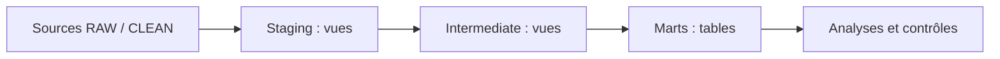

# Guide des transformations dbt

Ce sous-projet dbt organise les transformations analytiques de NexaRetail, de la préparation des données aux modèles destinés aux analyses et tableaux de bord.

## Organisation

- `models/staging/` : préparation et standardisation des données sources.
- `models/intermediate/` : transformations intermédiaires.
- `models/marts/` : tables analytiques pour les usages métier.
- `tests/` : tests SQL spécifiques.
- `macros/`, `seeds/`, `snapshots/` et `analyses/` : répertoires conventionnels de dbt, certains réservés à de futurs usages.
- `dbt_project.yml` : configuration du projet.

## Prérequis

PostgreSQL doit être accessible et les schémas sources nécessaires doivent déjà exister. La configuration de connexion se trouve dans `docker/dbt/profiles.yml` à la racine du dépôt. Le mot de passe est fourni par la variable d'environnement `DBT_POSTGRES_PASSWORD`, jamais dans Git.

## Commandes de contrôle

Le profil versionné dans `docker/dbt/profiles.yml` utilise l'hôte `postgres`, résolu dans le réseau Docker. Il **n'est pas directement adapté à une exécution dbt sur Windows** sans profil local distinct.

Depuis la racine du dépôt, avec Docker disponible et `DOCKER_POSTGRES_PASSWORD` défini :

```powershell
docker compose up -d postgres
docker compose build dbt
docker compose run --rm dbt debug
docker compose run --rm dbt build
```

Le service dbt est associé au profil Compose `tools` ; ces commandes explicites ciblent ce service. Les schémas `raw` et `clean` doivent être importés avant `dbt build`.

Ces commandes sont des indications de reproduction, **pas une affirmation qu'elles ont été relancées pendant le nettoyage**. Voir également [le guide Docker](../docker/README.md).

## Validation et limites

Le bilan historique consigne 16 modèles et 37 tests dbt (53 validations réussies lors des exécutions documentées). Il ne garantit pas une reconstruction intégrale dans un nouvel environnement. Voir [le bilan de validation](../docs/11_validation_reproductibilite.md) et [la feuille de route](../docs/feuille_de_route.md).

Les répertoires `target/`, `logs/` et `dbt_packages/` sont des artefacts locaux à exclure du versionnement.

---

## Architecture des transformations



Les matérialisations sont configurées dans `dbt_project.yml` : **staging** et **intermediate** en vues, **marts** en tables. Cette configuration ne garantit pas que toutes les relations sources sont déjà chargées.

## Fichiers de configuration vérifiés

| Fichier | Fonction |
|---|---|
| `dbt_project.yml` | Nom du projet, chemins et matérialisations |
| `../docker/dbt/profiles.yml` | Connexion PostgreSQL dans le réseau Compose |
| `../compose.yaml` | Services PostgreSQL et dbt |
| `../Dockerfile.dbt` | Image utilisée pour exécuter dbt |

Le profil `dbt_nexaretail` cible `postgres:5432` **à l'intérieur de Docker** et utilise `DBT_POSTGRES_PASSWORD`. Depuis Windows, l'hôte et le port peuvent différer : ne pas reprendre ce profil tel quel sans adapter l'environnement.

## Déroulement d'un build

| Étape | Commande | Ce qu'elle vérifie |
|---|---|---|
| Connexion | `docker compose run --rm dbt debug` | Configuration et accès à la base |
| Construction et tests | `docker compose run --rm dbt build` | Modèles et tests inclus dans la sélection |
| Analyse des erreurs | Logs dbt | Modèle, test et relation concernés |

Les commandes supposent un moteur Docker fonctionnel, une variable de mot de passe définie et les sources importées. Un `debug` réussi ne prouve pas que les données métier sont cohérentes.

## Interpréter les 53 validations historiques

Le bilan documente **16 modèles et 37 tests** réussis lors de la dernière exécution conservée. Il ne s'agit pas de 53 tests indépendants : le total comprend des modèles construits et des tests. Les résultats doivent être datés et associés à leur environnement avant toute revendication de reproductibilité.

## Cas de diagnostic

**Relation source absente :** vérifier l'import des schémas `raw` et `clean`, ainsi que le nom réellement attendu par les sources dbt.

**Erreur d'authentification :** vérifier la variable d'environnement côté Compose et le profil sans afficher le mot de passe.

**Test de clé étrangère en échec :** mesurer les références orphelines. Ne pas supprimer les lignes pour obtenir artificiellement un test vert.

**Écart avec Power BI :** vérifier la date de rafraîchissement, le scénario et le grain de la mesure.

## Liens utiles

[Guide Docker](../docker/README.md) | [Schéma relationnel](../docs/modele_donnees/01_schema_relationnel.md) | [Dictionnaire KPI](../docs/04_dictionnaire_indicateurs.md) | [Bilan de validation](../docs/11_validation_reproductibilite.md) | [Sommaire](../docs/INDEX.md)
