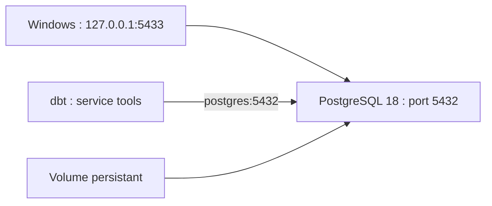

# Guide de l'environnement Docker

Ce dossier contient la configuration de connexion dbt utilisée avec Docker Compose. Le fichier `compose.yaml` et le fichier `Dockerfile.dbt` restent à la racine du dépôt, conformément aux chemins actuels du projet.

## Composants documentés

- PostgreSQL 18, base `nexaretail_db`, port hôte 5433 dans la configuration historique.
- dbt Core et adaptateur PostgreSQL.
- Profil dbt : `docker/dbt/profiles.yml`.

## Prérequis

Docker Desktop doit être démarré et le moteur Docker disponible. Définir la variable d'environnement `DOCKER_POSTGRES_PASSWORD` dans la session PowerShell avant le démarrage. Les secrets ne doivent pas être ajoutés à Git.

## Commandes de référence

À lancer **depuis la racine du dépôt**, uniquement si Docker est disponible et que les variables requises sont configurées :

```powershell
docker compose up -d postgres
docker compose build dbt
docker compose run --rm dbt debug
```

Les schémas sources `raw` et `clean` doivent être importés avant la construction des modèles. Les sauvegardes PostgreSQL restent locales.

Pour construire et tester les modèles :

```powershell
docker compose run --rm dbt build
```

Pour arrêter les conteneurs sans supprimer explicitement les volumes :

```powershell
docker compose down
```

## État de validation

Le bilan historique mentionne 16 modèles, 37 tests et 53 contrôles réussis. **Ces résultats ne constituent pas une validation de Docker à la date de ce nettoyage.** L'étape 11 a notamment documenté une variable d'environnement absente et un moteur Docker indisponible. Aucune réexécution Docker n'est nécessaire pour la réorganisation documentaire.

Voir [le bilan de validation](../docs/11_validation_reproductibilite.md) et [le guide dbt](../dbt_nexaretail/README.md).

---

## Topologie réelle de Compose



Le fichier `compose.yaml` expose PostgreSQL sur **127.0.0.1:5433** côté machine hôte. Le service dbt utilise le nom DNS `postgres` et le port **5432** dans le réseau Compose. Ces deux adresses répondent à des contextes différents.

## Configuration confirmée dans compose.yaml

| Élément | Valeur | Conséquence |
|---|---|---|
| Image PostgreSQL | `postgres:18` | Version majeure configurée |
| Base | `nexaretail_db` | Nom utilisé par le profil |
| Utilisateur | `postgres` | Compte configuré pour le conteneur |
| Mot de passe | `DOCKER_POSTGRES_PASSWORD` | Variable requise, jamais stockée dans Git |
| Port hôte | `127.0.0.1:5433` | Accessible depuis la machine locale |
| Port interne | `5432` | Utilisé par dbt dans Docker |
| Volume | `nexaretail_postgres_data` | Persistance entre arrêts ordinaires |
| Profil dbt | `tools` | Service lancé explicitement par les commandes |

## Procédure de diagnostic non destructive

```powershell
# Depuis la racine du dépôt
docker compose config
docker compose ps
docker compose logs postgres --tail 50
```

Ces commandes servent à examiner la configuration et l'état des services. `docker compose config` peut échouer si la variable obligatoire est absente. Éviter de publier sa sortie lorsqu'elle contient des valeurs sensibles.

### Erreurs connues et interprétation

| Message ou symptôme | Interprétation possible | Première action |
|---|---|---|
| Variable `DOCKER_POSTGRES_PASSWORD` manquante | Configuration incomplète | Définir le secret localement |
| Docker daemon indisponible | Docker Desktop ou moteur arrêté | Vérifier le service Docker |
| `dbt debug` échoue | Réseau, profil ou authentification | Examiner `profiles.yml` et les logs |
| Source `raw` absente | Import des données non effectué | Charger les schémas avant dbt |
| Port 5433 occupé | Autre service local | Vérifier les ports avant modification |

## Protection des données

`docker compose down` arrête et retire les conteneurs du projet, mais **ne supprime pas par défaut le volume nommé**. En revanche, `docker compose down -v` supprime les volumes associés et peut effacer les données PostgreSQL stockées dans le volume. Ne pas employer `-v` sans sauvegarde et décision explicite.

### Ce qui reste à prouver

Le dernier bilan dbt historique est positif, mais la reconstruction Docker sur un environnement neuf n'a pas été validée pendant cette revue. Les contrôles de la présente page sont des procédures recommandées, non des exécutions déclarées.

## Références

[Guide dbt](../dbt_nexaretail/README.md) | [Organisation technique](../docs/guides/organisation_technique.md) | [Bilan de validation](../docs/11_validation_reproductibilite.md) | [Sommaire](../docs/INDEX.md)
