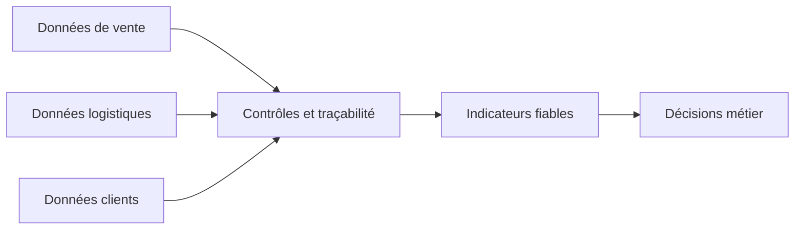

# 01 : NexaRetail : Contexte et ambition de transformation

**CONSULTAI 360 | DOSSIER DE CONSEIL**

[Accueil du projet](../README.md) | [Sommaire documentaire](INDEX.md) | [Application Streamlit](https://consultai-360.streamlit.app/)

> **CONSULTAI 360 / DOSSIER DE CADRAGE**  
> **Statut :** contexte métier fictif et hypothèses initiales, enrichis par les réalisations documentées | **Secteur :** distribution omnicanale | **Périmètre :** étude de cas, aucune entreprise cliente réelle.

[← Index documentaire](INDEX.md) | [Diagnostic →](02_diagnostic_metier.md) | [Rapport final](12_rapport_final_conseil.md)

## Regard consultant : ce que la direction doit retenir

La modernisation analytique ne commence pas par le choix d'un outil. Elle commence par un **accord sur la signification des données**. Une direction peut disposer de tableaux très soignés et prendre de mauvaises décisions si les montants non attribuables ou les exclusions sont invisibles.

### Trois décisions structurantes

| Décision | Option à éviter | Option retenue dans l'étude |
|:--|:--|:--|
| Traitement des anomalies | Supprimer toute ligne imparfaite | Préserver les événements et qualifier leur fiabilité |
| Développement de l'IA | Confier les calculs au modèle génératif | Séparer calcul déterministe et commentaire |
| Passage à l'échelle | Généraliser sur la base d'une démonstration | Préparer un pilote limité, mesurable et réversible |

### Questions ouvertes pour une mission réelle

- Quelles sources sont juridiquement et opérationnellement reconnues comme référentielles ?
- Qui arbitre un désaccord entre Finance, Commerce et Logistique sur la définition d'un KPI ?
- Quel niveau de couverture est acceptable pour décider, selon le risque associé ?
- Quels usages de l'IA justifient une intervention humaine systématique ?

Ces questions ne peuvent pas être résolues par les données synthétiques seules.

---
## L'essentiel en 30 secondes

NexaRetail est une **entreprise française fictive de distribution omnicanale**. Sa problématique n'est pas seulement de produire davantage de tableaux de bord : elle doit rendre ses données **traçables, comparables et utilisables pour décider**, tout en évitant de confondre expérimentation IA et déploiement industriel.

| Repère de simulation | Valeur de référence | Lecture |
|:--|--:|:--|
| Magasins | **35** | Réseau physique fictif |
| Clients | **120 000** | Population synthétique |
| Collaborateurs | **450** | Effectif fictif |
| Produits | **8 000** | Catalogue simulé |
| Commandes originales | **120 000** | Volume effectivement documenté dans le jeu ORIGINAL |
| Horizon de données | **24 mois** | Hypothèse de cadrage |
| Canaux | **Magasin + e-commerce** | Commerce omnicanal |

## Lecture de la situation

<strong>Point de méthode : donnée présente ou donnée utilisable ?</strong>

Une commande sans client identifié peut être comptée dans le volume global, mais ne peut pas être attribuée correctement à un segment. La qualité d'une donnée dépend donc de l'analyse prévue, et pas seulement de sa présence dans une table.

---

[Chapitre précédent](INDEX.md) | [Sommaire](INDEX.md) | [Chapitre suivant](02_diagnostic_metier.md)
