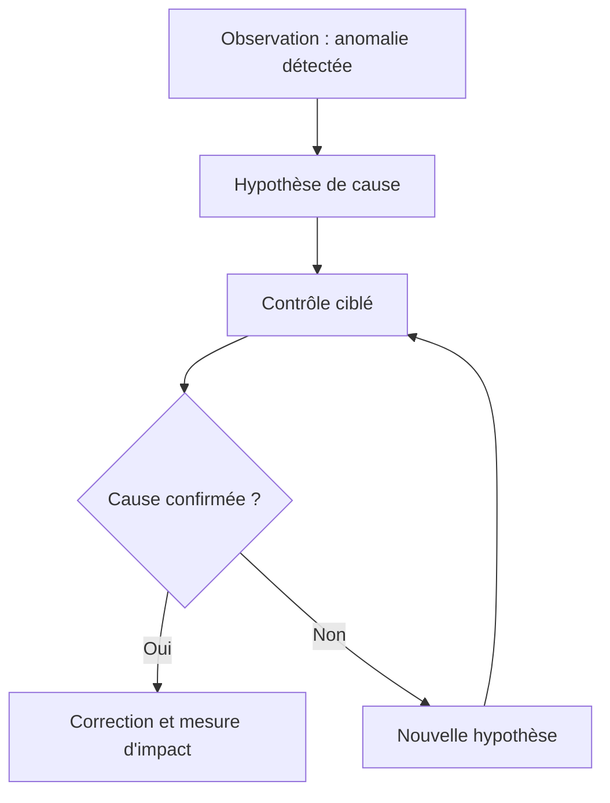

# 02 : Diagnostic métier : Du symptôme à la décision

<div align="center">

**CONSULTAI 360 | DOSSIER DE CONSEIL**

[Accueil du projet](../README.md) | [Sommaire documentaire](INDEX.md) | [Application Streamlit](https://consultai-360.streamlit.app/)

</div>


> **CONSULTAI 360 / DIAGNOSTIC INITIAL**  
> **Nature :** hypothèses métier d'une entreprise fictive, confrontées aux observations du projet | **Règle :** ne pas transformer une simulation en incident réellement subi.

[← Contexte](01_contexte_metier.md) | [Index](INDEX.md) | [Processus →](03_processus_metier.md)

## Plan d'investigation pour un diagnostic en entreprise

Le diagnostic présenté plus haut serait approfondi par des entretiens, un échantillonnage des données et une revue des contrôles existants.

| Séquence | Investigation | Livrable de décision |
|:--|:--|:--|
| **A. Écouter** | Entretiens avec responsables métier et utilisateurs | Carte des irritants et décisions affectées |
| **B. Mesurer** | Profils de données, taux de nulls, contrôles de clés | Registre des anomalies avec périmètre |
| **C. Réconcilier** | Comparaison de plusieurs calculs d'un même indicateur | Définition commune et exceptions |
| **D. Prioriser** | Impact métier, coût, urgence, dépendances | Backlog classé et propriétaires |
| **E. Tester** | Pilote ciblé avec mesure avant/après | Décision documentée de poursuite |

### Exemple de fiche d'incident qualité

| Champ | Exemple illustratif |
|:--|:--|
| Identifiant | DQ-REF-001 |
| Objet | Commande sans client attribuable |
| Impact | Segmentation commerciale incomplète |
| Détection | Anti-jointure entre commandes et référentiel clients |
| Traitement | Préserver la commande, exposer « Inconnu », rechercher la source fiable |
| Validation | Contrôle du nombre de lignes et des montants avant/après |
| Décision | Correction uniquement avec preuve d'identité |

*Cette fiche est un modèle de méthode, pas un ticket issu d'un système de production.*

---
## Synthèse de direction

Le risque majeur pour NexaRetail n'est pas uniquement la présence d'erreurs : c'est **l'illusion de précision** produite par des indicateurs qui masquent les données non attribuables. Le diagnostic recommande de traiter d'abord la confiance dans les données, ensuite leur exploitation analytique, puis les expérimentations IA et leur valeur économique.

| Enjeu | Risque métier | Réponse | Priorité logique |
|:--|:--|:--|:--|
| Qualité des données | KPI incomplets ou mal attribués | Contrôles Python/SQL/dbt | **P1 : Fondation** |
| Reporting fragmenté | Versions contradictoires d'un indicateur | DW et Power BI | **P2 : Pilotage** |
| Logistique | Retards difficiles à qualifier | Analyse des expéditions | **P2 : Pilotage** |
| Analyse commerciale | Décisions sur des périmètres incomplets | Mesures contextualisées | **P2 : Pilotage** |
| IA sans gouvernance | Recommandations non justifiées | Assistant contrôlé, pilote et ROI | **P3 : Expérimentation** |


**Limite d'interprétation :** Les causes ci-dessus ne sont **pas établies par une enquête de terrain**. Elles constituent des pistes de diagnostic à vérifier dans une mission réelle.

## 4. Priorisation et dépendances

```text
P1  Fiabiliser les données et définir les KPI
             |
             v
P2  Consolider le DW et les analyses Power BI
             |
             v
P3  Tester des cas d'usage ML et IA sous contrôle
             |
             v
P4  Évaluer coûts, bénéfices et conditions du pilote
             |
             v
     Décision GO / NO-GO documentée
```

Cette séquence décrit une **dépendance de décision**, pas une preuve que chaque composant est industrialisé.

## 5. Questions qu'un consultant poserait au client

1. Quelle définition du chiffre d'affaires fait autorité : commande, facturation ou encaissement ?
2. Qui valide une correction de référence client ou produit ?
3. Quel pourcentage des expéditions possède des dates suffisamment fiables pour mesurer le retard ?
4. Quelles décisions commerciales changeraient réellement grâce au dashboard ?
5. Quels coûts et gains du pilote sont **mesurables**, et lesquels ne sont que supposés ?
6. Quel responsable métier approuve les recommandations formulées par l'IA ?

## 6. Conclusion et orientation

**Recommandation :** adopter une transformation progressive, avec une priorité donnée à la qualité et à la traçabilité, puis à la diffusion d'indicateurs communs. Les composants IA doivent rester soumis à des tests et à une validation humaine.

**Suite du dossier :** [Cartographie des processus](03_processus_metier.md) | [Dictionnaire des KPI](04_dictionnaire_indicateurs.md) | [Rapport final de conseil](12_rapport_final_conseil.md)


## Analyse approfondie des défaillances possibles

### A. Complétude et capacité d'attribution

Une commande peut avoir un montant renseigné, mais ne plus être associable à un client ou à un magasin. Le total global et la ventilation par segment peuvent alors différer. La correction analytique consiste à conserver le total et à publier la part non attribuable, pas à supprimer la transaction.

### B. Intégrité référentielle

Une clé étrangère invalide rompt le lien entre deux tables. Un contrôle d'anti-jointure permet de recenser les références sans correspondance. Le diagnostic doit préciser le nombre de lignes, le nombre d'identifiants distincts et, si pertinent, les montants concernés.

### C. Cohérence temporelle

Les analyses mensuelles exigent une date valide. Une commande sans date ne peut pas être affectée honnêtement à un mois. La mesure temporelle doit présenter son périmètre et le nombre d'observations exclues.

### D. Risque de double comptage

Une commande possédant plusieurs lignes et plusieurs paiements peut produire un produit cartésien partiel lors d'une jointure mal construite. Une vérification des cardinalités doit précéder tout calcul de CA.

## Protocole d'audit recommandé

| Phase | Opération | Preuve attendue |
|---|---|---|
| Profilage | Volumes, types, nulls, distributions | Tableau de couverture |
| Cohérence | Bornes de dates, montants, statuts | Liste d'exceptions |
| Références | Anti-jointures sur clés métier | Références orphelines |
| Rapprochement | Comparaison entre tables de faits | Écarts expliqués |
| Publication | Définition et population de chaque KPI | Dictionnaire versionné |

### Exemple de contrôle SQL à adapter

```sql
SELECT
    COUNT(*) AS lignes,
    COUNT(DISTINCT order_id) AS commandes,
    COUNT(*) FILTER (WHERE order_id IS NULL) AS references_absentes
FROM raw.payments;
```

Ce SQL illustre une méthode de contrôle. Le nom exact du schéma et des colonnes doit être confirmé avant exécution dans l'environnement du projet.

## Comment prioriser une anomalie

La gravité ne dépend pas uniquement du volume. Une erreur rare touchant un indicateur financier critique peut être plus urgente qu'un défaut fréquent sur un champ décoratif.

| Critère | Question |
|---|---|
| Impact métier | Quelle décision peut être faussée ? |
| Fréquence | Combien de lignes ou de transactions ? |
| Détectabilité | Peut-on isoler les cas automatiquement ? |
| Réversibilité | Existe-t-il une source fiable de correction ? |
| Coût | Quel effort de traitement et de prévention ? |

Dans une mission réelle, cette grille serait discutée avec les propriétaires métier. Aucun score arbitraire n'est présenté ici comme une mesure observée.

## Comment lire un diagnostic



<details><summary><strong>Exemple de distinction entre constat et hypothèse</strong></summary>

Un taux de valeurs manquantes est mesurable. Une mauvaise synchronisation entre systèmes peut l'expliquer, mais cette cause doit être testée. Dans le cas NexaRetail, l'organisation est fictive : aucune enquête terrain n'a confirmé une cause organisationnelle.

</details>

---

[Chapitre précédent](01_contexte_metier.md) | [Sommaire](INDEX.md) | [Chapitre suivant](03_processus_metier.md)
