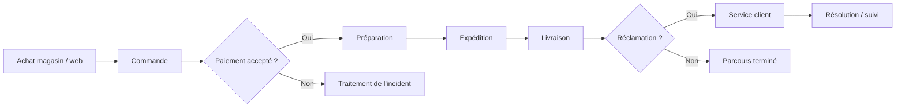
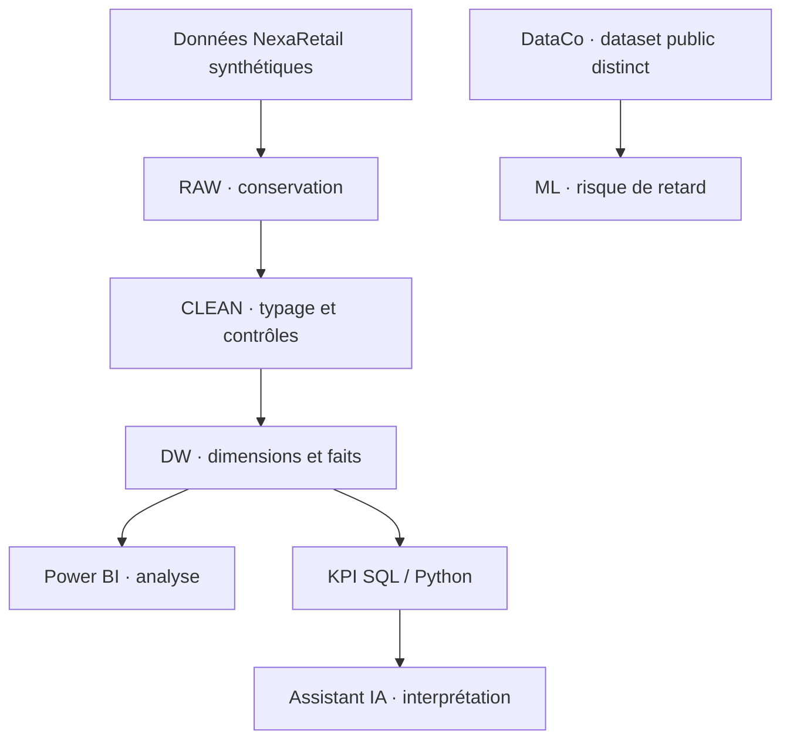

# 03 · Cartographie des processus — Du panier à la résolution

> **CONSULTAI 360 / PROCESSUS OPÉRATIONNELS**  
> **Périmètre :** parcours omnicanal simulé · **Objectif :** relier opérations, tables de données, contrôles et décisions.

[← Diagnostic](02_diagnostic_metier.md) · [Index](INDEX.md) · [KPI →](04_dictionnaire_indicateurs.md)

---

## Vue d'ensemble du parcours

> [!IMPORTANT]
> Ce diagramme est une **cartographie métier conceptuelle**, pas un moteur de workflow implémenté. Le parcours en magasin peut différer du parcours e-commerce : toutes les commandes ne nécessitent pas une expédition.

## 1. Parcours de bout en bout

| Étape | Déclencheur / activité | Données associées | Contrôle essentiel | KPI / décision |
|:--|:--|:--|:--|:--|
| **01 · Vente** | Client passe commande | `orders`, `order_items`, `customers` | Identifiants, quantités, montants | Commandes, panier moyen |
| **02 · Paiement** | Paiement enregistré | `payments` | Référence commande, statut, montant | Couverture et rapprochement |
| **03 · Préparation** | Articles à préparer | `orders`, `inventory`, `products` | Disponibilité et cohérence produit | Incidents de préparation, si données disponibles |
| **04 · Expédition** | Colis pris en charge | `shipments` | Référence commande, mode, dates | Expéditions évaluables |
| **05 · Livraison** | Livraison constatée | `shipments` | Date réelle vs date prévue | Taux de retard, délai |
| **06 · Après-vente** | Incident ou réclamation | `complaints` | Référence, motif, statut | Réclamations, résolution si dates disponibles |

Les noms de tables correspondent au **modèle de données synthétiques** ; ils ne signifient pas que chaque étape possède une application opérationnelle complète.

## 2. Description des six étapes

### 01 — Enregistrer la vente

**Entrées :** client, canal, produits, quantités et prix.  
**Sorties :** commande et lignes associées.  
**Point de rupture :** une référence client ou produit absente peut empêcher une ventilation correcte, même si la transaction est conservée.

**Contrôle recommandé :** distinguer commandes comptées, montants renseignés et commandes attribuables.

### 02 — Enregistrer et rapprocher le paiement

Une commande et un paiement ne sont pas la même unité d'analyse. Une commande peut donner lieu à plusieurs événements de paiement ; une référence invalide peut rendre un paiement non rattachable.

**Contrôle recommandé :** vérifier l'intégrité référentielle et analyser les paiements non rapprochés **sans inventer de commande de substitution**.

### 03 — Préparer les articles

La préparation relie le contenu de la commande aux produits et aux stocks disponibles. Les données de stock constituent un support d'analyse ; elles ne prouvent pas qu'un système complet de gestion d'entrepôt a été développé.

**Contrôle recommandé :** cohérence produit–quantité et documentation des cas non évaluables.

### 04 — Expédier

Le processus d'expédition produit des informations sur le mode d'envoi, les dates et le suivi. Il faut éviter d'assimiler **nombre d'expéditions** et **nombre de commandes**, puisque les granularités peuvent différer.

**Contrôle recommandé :** définir la population éligible à chaque analyse.

### 05 — Mesurer la livraison

Un retard suppose une règle métier, par exemple **date réelle postérieure à la date prévue**, et la présence des deux dates pertinentes. Une date manquante doit être classée « non évaluable », pas automatiquement « à temps ».

**Contrôle recommandé :** publier le numérateur, le dénominateur et la couverture des données.

### 06 — Traiter la réclamation

Une réclamation peut concerner un retard, un produit ou un paiement. Le nombre de réclamations ne se confond pas avec le nombre de commandes ayant au moins une réclamation.

**Contrôle recommandé :** compter distinctement les tickets et les commandes concernées selon la question métier.

## 3. Matrice de responsabilité simulée

| Activité | Commercial | Finance | Logistique | Service client | Équipe Data |
|:--|:--:|:--:|:--:|:--:|:--:|
| Commande et canal | **Pilote** | Consulte | Consulte | Consulte | Contrôle |
| Paiement et rapprochement | Consulte | **Pilote** | — | Consulte | Contrôle |
| Préparation / livraison | — | Consulte | **Pilote** | Consulte | Contrôle |
| Réclamations | Consulte | Consulte | Consulte | **Pilote** | Contrôle |
| Définition des KPI | Contribue | Contribue | Contribue | Contribue | **Formalise** |

**Pilote** désigne une responsabilité métier fictive. Cette matrice ne constitue pas un organigramme validé par un client.

## 4. Risques de rupture de la chaîne de données

| Rupture | Effet analytique | Réponse de gouvernance |
|:--|:--|:--|
| Client inconnu | CA non attribuable à un segment | Membre technique « Inconnu » et mesure de couverture |
| Produit inconnu | Ventilation produit incomplète | Conserver la ligne et tracer l'anomalie |
| Paiement sans commande | Rapprochement incomplet | Conserver le paiement sans rattachement artificiel |
| Date de commande absente | Série temporelle incomplète | Publier le volume exclu des analyses datées |
| Date de livraison non exploitable | Retard non calculable | Catégorie « non évaluable » |
| Réclamation sans contexte fiable | Analyse des causes fragilisée | Éviter toute attribution causale non démontrée |

## 5. Architecture analytique associée

La branche **DataCo** est indépendante de la chaîne transactionnelle NexaRetail.

## 6. Cas d'usage décisionnels

- **Direction commerciale :** comparer les canaux sans ignorer les ventes non attribuables.
- **Finance :** expliquer pourquoi les montants de commandes, ventes et paiements ne coïncident pas nécessairement.
- **Logistique :** comparer les retards par mode uniquement sur les livraisons évaluables.
- **Service client :** rapprocher les réclamations des événements disponibles, sans présumer leur cause.
- **Direction générale :** prioriser les initiatives sur la base d'une valeur estimée, de risques identifiés et d'un pilote mesurable.

## 7. Limites et suite

La cartographie représente un **processus cible simplifié**. Elle ne documente ni procédures internes réelles, ni SLA contractuels, ni intégrations ERP ou transporteurs opérationnelles.

**Suite :** [04 · Dictionnaire des KPI](04_dictionnaire_indicateurs.md) · [05 · Périmètre du projet](05_perimetre_projet.md) · [Rapport Power BI](10_rapport_power_bi.md)
