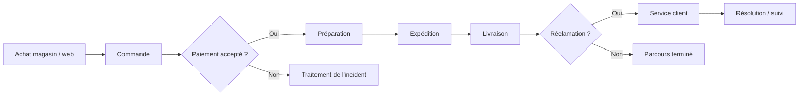
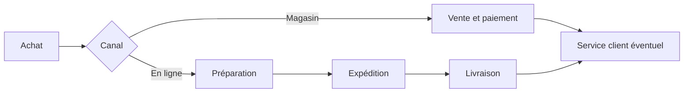

# 03 : Cartographie des processus : Du panier à la résolution

**CONSULTAI 360 | DOSSIER DE CONSEIL**

[Accueil du projet](../README.md) | [Sommaire documentaire](INDEX.md) | [Application Streamlit](https://consultai-360.streamlit.app/)

> **CONSULTAI 360 / PROCESSUS OPÉRATIONNELS**  
> **Périmètre :** parcours omnicanal simulé | **Objectif :** relier opérations, tables de données, contrôles et décisions.

[← Diagnostic](02_diagnostic_metier.md) | [Index](INDEX.md) | [KPI →](04_dictionnaire_indicateurs.md)

## Contrôles de bout en bout : cas de test métier

Ces scénarios sont des **cas de recette conceptuels**. Ils servent à expliciter les comportements attendus d'une chaîne analytique.

| Cas | Situation | Comportement attendu |
|:--|:--|:--|
| **CT-01** | Commande valide, paiement valide | Rapprochement possible sans duplication du montant |
| **CT-02** | Commande sans client connu | Commande conservée, attribution client signalée |
| **CT-03** | Paiement avec commande introuvable | Paiement conservé, référence non rattachable |
| **CT-04** | Expédition sans date réelle | Retard déclaré non évaluable |
| **CT-05** | Deux paiements pour une commande | Aucun double comptage des commandes |
| **CT-06** | Deux réclamations pour une commande | Distinguer deux tickets et une commande concernée |
| **CT-07** | Commandes de scénarios différents avec même ID | Jointures conditionnées au scénario |

### Deux parcours à distinguer

**Achat en magasin :** vente, paiement, éventuel retrait ou service après-vente. Une expédition n'est pas systématique.

**Achat en ligne :** vente, paiement, préparation, expédition, livraison, éventuelle réclamation. Les indicateurs logistiques doivent se limiter aux événements pertinents.

### Règle de modélisation

La chaîne opérationnelle peut être représentée comme une suite d'étapes, mais les **tables analytiques ne sont pas nécessairement en relation un-à-un**. Le choix du grain doit précéder la création des mesures.

---
## Vue d'ensemble du parcours

## Processus détaillés et points de contrôle

### 1. Vente et constitution de la commande

La commande regroupe un événement d'achat. Les lignes de commande décrivent les articles et quantités. Le modèle analytique doit préserver cette distinction pour éviter de multiplier le montant d'une commande lors d'une jointure avec les lignes.

**Contrôles :** identifiant de commande, présence des articles, cohérence des quantités, canal, magasin éventuel et date de transaction.

### 2. Paiement et rapprochement

Le paiement constitue un événement financier distinct. Une commande peut être associée à plusieurs paiements. Il faut donc choisir explicitement si l'analyse porte sur les montants commandés, payés ou effectivement encaissés.

**Contrôles :** référence commande, statut de paiement, montants, paiements sans commande et pluralité des paiements.

### 3. Stock et préparation

Le stock renseigne la disponibilité théorique des produits. Il ne prouve pas à lui seul qu'un article a été préparé ni qu'un entrepôt a respecté un délai. Les conclusions doivent se limiter aux champs réellement disponibles.

**Contrôles :** référence produit, quantités, cohérence des stocks et période de référence.

### 4. Expédition et livraison

Le suivi logistique s'appuie sur les dates d'expédition, de livraison prévue et de livraison réelle. Un retard ne peut être évalué que si les dates requises sont présentes et interprétables.

**Contrôles :** dates impossibles, références orphelines, modes d'expédition, doublons d'événements et couverture des livraisons.

### 5. Réclamation et traitement

Les réclamations sont des événements de service client. Une commande peut comporter plusieurs réclamations. La question « combien de tickets ? » diffère donc de « combien de commandes touchées ? ».

**Contrôles :** identifiant de ticket, commande associée, motif, statut et éventuelles dates de résolution.

## Matrice de rapprochement

| Source A | Source B | Risque de jointure | Contrôle |
|---|---|---|---|
| Commandes | Lignes de commande | Multiplication des commandes | Compter les commandes distinctes |
| Commandes | Paiements | Multiplication des montants | Agréger les paiements avant rapprochement si nécessaire |
| Commandes | Expéditions | Plusieurs événements par commande | Définir le grain expédition |
| Commandes | Réclamations | Plusieurs tickets par commande | Distinguer tickets et commandes concernées |

## Exemple d'incident de bout en bout

Une commande apparaît dans les ventes, mais la référence client est invalide. La commande reste visible dans le CA global. Elle est placée dans une catégorie non attribuable pour l'analyse client. Un contrôle d'intégrité détecte l'incident ; le dashboard affiche la couverture de segmentation ; une correction n'est appliquée que si une référence fiable est retrouvée.

Cette approche évite qu'une anomalie de référentiel fasse disparaître une activité commerciale de l'analyse.

## Lecture du parcours omnicanal

<strong>Pourquoi distinguer commande et expédition ?</strong>

Une commande peut contenir plusieurs articles et donner lieu à plusieurs événements logistiques. Compter les lignes après une jointure peut donc gonfler artificiellement un montant. Il faut vérifier la granularité et les cardinalités avant d'agréger.

---

[Chapitre précédent](02_diagnostic_metier.md) | [Sommaire](INDEX.md) | [Chapitre suivant](04_dictionnaire_indicateurs.md)
