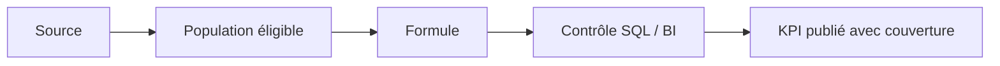

# 04 : Dictionnaire des indicateurs : Référentiel KPI

<div align="center">

**CONSULTAI 360 | DOSSIER DE CONSEIL**

[Accueil du projet](../README.md) | [Sommaire documentaire](INDEX.md) | [Application Streamlit](https://consultai-360.streamlit.app/)

</div>


> **CONSULTAI 360 / CONTRAT DE MESURE**  
> **Version :** référentiel enrichi | **Périmètre :** NexaRetail synthétique, expérience ML DataCo indépendante, ROI hypothétique.

[← Processus](03_processus_metier.md) | [Index](INDEX.md) | [Périmètre →](05_perimetre_projet.md)

## Exemples de lecture : les pièges les plus fréquents

### Cas A : un panier moyen artificiellement faible

Si le CA ne porte que sur les commandes dont le montant est renseigné, mais que le dénominateur inclut toutes les commandes, le panier moyen est mécaniquement abaissé. Le calcul doit donc préciser la population utilisée.

### Cas B : une amélioration apparente du taux de retard

Un taux peut diminuer si des livraisons problématiques deviennent non évaluables. **La couverture des dates doit être publiée à côté du taux**, sinon l'amélioration peut être trompeuse.

### Cas C : une hausse des alertes ML

Abaisser un seuil de classification peut accroître le rappel et le volume d'alertes, au prix de davantage de faux positifs. Le seuil de 0,40 doit être interprété dans le contexte du coût métier des erreurs, et non comme un optimum universel.

### Cas D : un ROI positif sans décision immédiate

Un scénario financier favorable n'annule ni les risques d'intégration, ni l'incertitude des gains, ni les coûts exclus. La recommandation d'un pilote peut donc être cohérente avec un ROI théorique positif.

## Gabarit pour ajouter un KPI

```yaml
nom: "Nom lisible du KPI"
question_metier: "Quelle décision ce KPI aide-t-il à prendre ?"
source: "Table ou requête de référence"
granularite: "commande | ligne | paiement | expedition"
scenario: "ORIGINAL | LOW | MEDIUM | CRITICAL"
numerateur: "Règle exacte"
denominateur: "Population éligible"
exclusions: "Nulls, statuts, dates et autres filtres"
controle: "Rapprochement SQL ou test attendu"
limites: "Biais et cas non évaluables"
```

Ce gabarit est un **modèle documentaire**, pas une configuration exécutable.

---
## Principe fondamental

> **Un KPI = une définition + une source + une granularité + un dénominateur + des filtres + une règle de gestion des données manquantes.**

Le dictionnaire initial proposait des indicateurs métier génériques. Cette version distingue **définition cible**, **mesure réellement disponible** et **indicateur à ne pas afficher sans données suffisantes**. Les formules ci-dessous sont des règles métier ; elles ne prétendent pas reproduire mot pour mot toutes les mesures DAX.

## 1. Règles transversales

| Dimension de contrôle | Règle |
|:--|:--|
| **Scénario** | Ne jamais joindre ORIGINAL, LOW, MEDIUM et CRITICAL sans clé de scénario |
| **Grain** | Distinguer commande, ligne de vente, paiement, expédition, réclamation |
| **Montants** | Ne pas assimiler montant de commande, montant de ligne et encaissement |
| **Valeurs nulles** | Afficher complétude et exclusions ; ne pas remplacer silencieusement par zéro |
| **Dates** | Préciser la date utilisée : commande, expédition, livraison |
| **Ratios** | Protéger la division par zéro et définir la population éligible |
| **Comparaison** | Vérifier même période, même scénario et même périmètre |
| **Gouvernance** | Versionner la définition si la règle change |

## 2. Ventes et finance

| KPI | Définition opérationnelle | Grain / vigilance |
|:--|:--|:--|
| **Nombre de commandes** | `COUNT(DISTINCT order_id)` sur le périmètre défini | Commande ; statut et scénario à préciser |
| **CA mesuré des commandes** | Somme des montants de commande **renseignés** | Commande ; ne pas qualifier automatiquement de CA net |
| **Panier moyen mesuré** | CA des commandes renseignées ÷ nombre de commandes avec montant renseigné | Éviter de diviser par toutes les commandes si certaines n'ont pas de montant |
| **Part online** | Commandes du canal en ligne ÷ commandes avec canal évaluable | Définir si part en **nombre** ou en **montant** |
| **CA par magasin** | Somme du montant selon la règle d'attribution magasin | Inclure/mesurer les non attribuables |
| **Complétude du montant** | Commandes avec montant ÷ commandes contrôlées | Accompagne tout CA affecté par des nulls |
| **CA net** | Ventes − remises − remboursements selon règles validées | **Indicateur cible** : ne pas l'assimiler au CA mesuré sans rapprochement |
| **Marge brute** | CA net − coût des produits vendus | **Conditionnel** à la disponibilité de coûts fiables |

### Exemple de lecture documentée : scénario MEDIUM

| Mesure | Valeur | Signification |
|:--|--:|:--|
| Commandes | **120 000** | Volume du scénario |
| Montants renseignés | **114 000** | 95 % de complétude |
| Montants manquants | **6 000** | 5 % de non-complétude |
| CA mesuré | **68 448 127,94 €** | Somme des montants connus |
| Panier moyen sur montants renseignés | **600,42 €** | 68 448 127,94 ÷ 114 000, arrondi |

**Limite d'interprétation :** Un **montant manquant dans la donnée** n'est pas une vente perdue. Les résultats d'autres vues Power BI peuvent utiliser des granularités ou définitions différentes ; tout rapprochement doit préciser la mesure comparée.

## 3. Logistique

| KPI | Formule / règle | Population |
|:--|:--|:--|
| **Expéditions** | Nombre d'enregistrements d'expédition selon identifiant retenu | Expéditions |
| **Expéditions évaluables** | Expéditions disposant des informations nécessaires à la règle de retard | Sous-ensemble évaluable |
| **Retards** | Nombre d'expéditions évaluables dont la livraison réelle dépasse la date prévue | Évaluables |
| **Taux de retard** | Retards ÷ expéditions évaluables × 100 | **Ne pas utiliser toutes les commandes** |
| **Taux à temps** | Livraisons à temps ÷ expéditions évaluables × 100 | Même règle d'éligibilité |
| **Couverture logistique** | Expéditions évaluables ÷ expéditions totales × 100 | Toutes les expéditions |
| **Délai moyen** | Moyenne des durées calculables selon les dates définies | Exclure explicitement les dates non exploitables |
| **Délai de préparation** | Fin de préparation − validation | **Conditionnel** aux horodatages disponibles |

**Exemple documenté MEDIUM :** 70 567 expéditions ; 70 005 évaluables ; 10 333 en retard ; **14,76 %** de retard (arrondi). Les 562 non évaluables ne doivent pas être classées comme ponctuelles.

## 4. Qualité des données

| KPI | Formule | Attention |
|:--|:--|:--|
| **Complétude** | Valeurs présentes ÷ valeurs attendues × 100 | Définir champs et population |
| **Taux de doublons** | Enregistrements identifiés comme doublons ÷ enregistrements contrôlés × 100 | Préciser clé et définition du doublon |
| **Taux de références invalides** | Lignes dont la référence n'existe pas ÷ lignes contrôlées × 100 | Une même transaction peut comporter plusieurs anomalies |
| **Taux d'anomalies** | Éléments anormaux ÷ éléments contrôlés × 100 | **Ne pas mélanger cellules et lignes** |
| **Précision de détection** | VP ÷ (VP + FP) | Nécessite une vérité terrain |
| **Rappel de détection** | VP ÷ (VP + FN) | Nécessite une vérité terrain |
| **F1-score** | 2 × précision × rappel ÷ (précision + rappel) | Éviter toute confusion avec le F1 du ML |

Les **82 953 anomalies de référence** mentionnées dans le README sont des lignes affectées dans plusieurs tables, **pas 82 953 commandes distinctes**.

## 5. Machine Learning : DataCo uniquement

| Indicateur | Sens | Valeur finale documentée |
|:--|:--|--:|
| **ROC AUC** | Capacité globale de classement des scores | **76,05 %** |
| **Rappel** | Part des retards réels détectés | **77,66 %** |
| **Précision** | Part des alertes positives correspondant à des retards | **65,88 %** |
| **F1-score** | Équilibre précision/rappel | **71,29 %** |
| **Seuil de classification** | Seuil retenu pour convertir le score en alerte | **0,40** |

Les métriques proviennent de l'[évaluation finale DataCo](08_rapport_final_prediction.md). Elles **ne mesurent pas** les performances d'un modèle déployé chez NexaRetail. Une AUC n'est pas une exactitude.

## 6. Assistant IA et pilotage

| KPI / critère | Règle | Statut |
|:--|:--|:--|
| Conformité d'une réponse | Respect des sections et des garde-fous définis | Contrôle applicatif |
| Exactitude factuelle | Faits corrects ÷ faits évalués | À mesurer sur un protocole explicitement documenté |
| Temps de reporting | Temps entre demande et restitution | À instrumenter pour démontrer un gain |
| Gain de temps | Temps de référence − temps après changement | **Hypothèse** tant qu'aucun pilote n'est mesuré |
| Coût d'exploitation | Charges opérationnelles incluses dans le modèle | Définir horizon et exclusions |

**Règle de sécurité analytique :** les chiffres sont produits par SQL/Python ; le modèle génératif **commente**, sans inventer de nouveaux KPI.

## 7. ROI : interprétation financière

`ROI = (bénéfices estimés − coûts retenus) / coûts retenus × 100`, pour un horizon et un périmètre de coûts **explicitement identiques**.

| Scénario | ROI hypothétique documenté | Lecture |
|:--|--:|:--|
| Prudent | **36,5 %** | Hypothèses conservatrices |
| Central | **110 %** | Hypothèses intermédiaires |
| Optimiste | **194 %** | Hypothèses favorables |


## Exemple chiffré : pourquoi le dénominateur compte

Dans le scénario MEDIUM, **114 000 commandes** ont un montant renseigné sur **120 000**. Le CA mesuré est de **68 448 127,94 €**.

| Méthode | Calcul | Résultat arrondi |
|---|---|---:|
| Panier sur montants connus | 68 448 127,94 / 114 000 | **600,42 €** |
| Division sur toutes les commandes | 68 448 127,94 / 120 000 | **570,40 €** |
| Écart de définition | 600,42 - 570,40 | **30,02 €** |

Le second résultat n'est pas un panier moyen comparable au premier : il mélange des montants connus et des commandes sans montant. La différence provient du **choix du dénominateur**, pas d'une variation des achats.

## Distinguer qualité des données et qualité du modèle

| Domaine | Exemple de métrique | Ce qu'elle mesure |
|---|---|---|
| Données | Complétude des montants | Proportion de montants disponibles |
| Logistique | Couverture des expéditions | Proportion de livraisons évaluables |
| ML | Rappel | Retards effectivement détectés |
| ML | Précision | Alertes positives réellement confirmées |
| Finance | ROI hypothétique | Relation entre gains supposés et coûts retenus |

Les pourcentages ne sont pas interchangeables. Un taux de complétude élevé ne garantit pas l'exactitude des montants ; un bon rappel ML ne démontre pas une amélioration du service.

## Règles de contrôle avant publication

1. Identifier la table de référence et le grain.
2. Définir précisément les filtres de scénario et de période.
3. Vérifier les lignes exclues ou non évaluables.
4. Contrôler le résultat sur un petit échantillon connu.
5. Rapprocher SQL et Power BI avec les mêmes filtres.
6. Indiquer les limites de lecture à côté du visuel.

### Exemple SQL de principe

```sql
SELECT
    COUNT(*) AS commandes,
    COUNT(total_amount) AS montants_renseignes,
    SUM(total_amount) AS ca_mesure,
    AVG(total_amount) AS panier_sur_montants_connus
FROM dw.fact_orders
WHERE scenario = 'medium';
```

Cette requête est un **pseudo-exemple SQL** : les noms de colonnes et le champ de scénario n'ont pas été confirmés ici dans le schéma physique. Ne pas l'exécuter tel quel sans vérifier les définitions du Data Warehouse.

## Du calcul à l'interprétation



<details><summary><strong>Pourquoi publier la couverture avec le taux de retard ?</strong></summary>

Si certaines expéditions ne disposent pas des dates nécessaires, leur statut de retard est inconnu. Le taux calculé sur les seules expéditions évaluables doit être accompagné du nombre d'observations exclues.

</details>

---

[Chapitre précédent](03_processus_metier.md) | [Sommaire](INDEX.md) | [Chapitre suivant](05_perimetre_projet.md)
