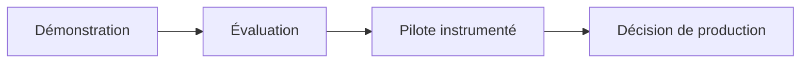

# 05 : Périmètre de mission : Inclus, exclus, conditions

<div align="center">

**CONSULTAI 360 | DOSSIER DE CONSEIL**

[Accueil du projet](../README.md) | [Sommaire documentaire](INDEX.md) | [Application Streamlit](https://consultai-360.streamlit.app/)

</div>


> **CONSULTAI 360 / PROJECT SCOPE**  
> **Statut :** cadrage initial (180 h prévisionnelles) enrichi d'une lecture des livrables documentés.  
> **Principe :** distinguer **intention**, **prototype réalisé** et **solution déployée**.

[← Dictionnaire KPI](04_dictionnaire_indicateurs.md) | [Index](INDEX.md) | [Charte →](06_charte_projet.md)

## Matrice de décision : ce qui est démontré et ce qui reste à prouver

| Niveau | Exemple ConsultAI 360 | Preuve attendue pour aller plus loin |
|:--|:--|:--|
| **Démonstration** | Rapport Power BI et assistant local | Usage compréhensible, sources identifiées |
| **Évaluation** | Modèle ML testé sur DataCo | Comparaison à des références, stabilité |
| **Pré-pilote** | Scénarios ROI et feuille de route | Hypothèses validées avec les métiers |
| **Pilote** | Expérimentation en environnement contrôlé | KPI avant/après, coût réel, incidents |
| **Production** | Non revendiquée dans ce projet | Sécurité, supervision, exploitation, responsabilités |

### Contrôle des demandes d'extension

Avant d'ajouter une fonctionnalité, documenter :

1. **Décision visée :** quel utilisateur fera quoi différemment ?
2. **Données nécessaires :** existe-t-il une source suffisamment fiable ?
3. **Démonstration minimale :** quel résultat permet de tester l'hypothèse ?
4. **Coût de maintien :** qui surveille, corrige et met à jour ?
5. **Critère d'arrêt :** dans quel cas abandonner l'initiative ?

Une extension sans critère d'arrêt augmente le périmètre sans nécessairement améliorer la valeur.

---
## 1. Mandat

ConsultAI 360 simule une mission de conseil Data & IA pour NexaRetail, distributeur omnicanal fictif. La mission vise à montrer comment des données imparfaites peuvent être structurées, contrôlées, analysées et utilisées pour préparer une décision d'investissement.

**Ce que la mission produit :** des artefacts de démonstration, des mesures, des analyses et des recommandations.  
**Ce qu'elle ne produit pas :** un système opérationnel exploité par une entreprise réelle.

## 2. Les quatre centres de capacité

| Centre | Objectif métier | Livrables documentés | Limite principale |
|:--|:--|:--|:--|
| **01 | Data Quality** | Rendre les erreurs visibles et quantifiables | Génération synthétique, scénarios d'anomalies, audits Python/SQL | CLEAN n'est pas « sans anomalie » |
| **02 | BI & Data Engineering** | Consolider une lecture commune | PostgreSQL RAW/CLEAN/DW, dbt, Power BI à **7 pages** | Reconstruction intégrale non démontrée sur machine vierge |
| **03 | Predictive Analytics** | Tester une méthode d'alerte logistique | Random Forest évalué sur **DataCo** | Aucun transfert validé vers NexaRetail |
| **04 | AI Consulting** | Faciliter l'interprétation de KPI calculés | Streamlit, assistant local Ollama, API FastAPI documentée | Pas d'autonomie décisionnelle ni de garantie de vérité des commentaires |

### Extension : conseil financier et stratégie

Trois scénarios ROI **hypothétiques**, une priorisation des initiatives, des recommandations et une trajectoire de pilote complètent les quatre centres. Le [rapport final](12_rapport_final_conseil.md) explicite les hypothèses et les réserves.

## 3. Périmètre des données

```text
NexaRetail (fictif)                  DataCo (public, distinct)
ORIGINAL / LOW / MEDIUM / CRITICAL   Prédiction de retard
          |                                  |
          v                                  v
Qualité → PostgreSQL → dbt → DW       Entraînement / évaluation
          |                                  |
          v                                  v
     Power BI / KPI                    Rapport ML séparé
          |
          v
   Assistant / Conseil / ROI
```

**Règle de séparation :** aucun résultat DataCo n'est présenté comme une prédiction validée sur les commandes NexaRetail. Les données publiques d'avis clients explorées séparément ne deviennent pas des avis authentiques de clients NexaRetail.

## 4. Évolution du périmètre

| Dimension | Cadrage initial | État documenté |
|:--|:--|:--|
| Dashboard | **4 pages** envisagées | **7 pages** décrites dans le rapport Power BI |
| ML | Jeu public à sélectionner | **DataCo**, problème de retard de livraison |
| Assistant | Interface et diagnostics | **Streamlit + Ollama** avec contrôles de commentaires |
| API | Technologie optionnelle | **FastAPI** documentée, sans prétention de service de production |
| dbt | Transformations et tests | **16 modèles, 37 tests**, dernier bilan historique **53/53 PASS** |
| ROI | Trois scénarios à construire | Scénarios prudent, central, optimiste documentés |
| Restitution | Rapport et présentation | Rapport final et présentation de direction |

Ces éléments sont des **réalisations ou états documentés**, pas une certification d'intégration complète. Voir [validation et reproductibilité](11_validation_reproductibilite.md).

## 5. Hors périmètre

- Plateforme e-commerce et système de paiement réels.
- Application mobile et système ERP/WMS complet.
- Infrastructure cloud de production, haute disponibilité et supervision 24/7.
- Déploiement du modèle ML sur des données opérationnelles NexaRetail.
- Entraînement d'un grand modèle de langage.
- Décisions stratégiques ou corrections de données exécutées automatiquement par l'IA.
- Évaluation causale d'un gain financier réel.
- Garantie de conformité réglementaire ou d'industrialisation de bout en bout.

## 6. Hypothèses, dépendances et contraintes

| Sujet | Hypothèse / contrainte | Conséquence |
|:--|:--|:--|
| Temps | **180 h prévisionnelles** au cadrage | Ce chiffre n'est pas un relevé du temps réellement passé |
| Données | Jeux internes synthétiques ; sources publiques distinctes | Les conclusions ne sont pas généralisables sans validation |
| Environnement | PostgreSQL, Python, dbt, Power BI et outils locaux | Dépendances et configurations nécessaires |
| Sécurité | Aucun secret ni donnée sensible à publier | Variables d'environnement et accès contrôlés |
| Reproductibilité | Résultats et commandes documentés | Pas de promesse de reconstruction « un clic » |
| IA | Commentaires encadrés par des calculs vérifiés | Revue humaine indispensable |

## 7. Critères d'acceptation

| Critère | Preuve attendue | Référence |
|:--|:--|:--|
| Jeux et anomalies compréhensibles | Schéma, scénarios, audit | [Modèle de données](modele_donnees/01_schema_relationnel.md) |
| Calculs de référence traçables | SQL, définitions KPI | [Dictionnaire](04_dictionnaire_indicateurs.md) |
| Transformations testées | Résultats de tests datés | [Bilan de validation](11_validation_reproductibilite.md) |
| Dashboard explicable | Pages, sources, limites | [Rapport BI](10_rapport_power_bi.md) |
| ML évalué sans fuite de cible | Protocole, métriques, limites | [Rapport ML](08_rapport_final_prediction.md) |
| Assistant maîtrisé | Contrôles, API et limites | [Documentation API](09_documentation_api.md) |
| ROI prudent | Hypothèses et scénarios | [Rapport de conseil](12_rapport_final_conseil.md) |
| Décision explicite | Conditions d'un pilote | [Rapport de conseil](12_rapport_final_conseil.md) |

## 8. Critères de changement de périmètre

Toute extension doit répondre à quatre questions : **quelle valeur métier ? quelle preuve de faisabilité ? quel coût de maintenance ? quel risque supplémentaire ?** Une fonction séduisante mais non vérifiable reste un prototype, pas un livrable de production.

## 9. Conclusion

Le périmètre est volontairement **large en démonstration de compétences** et **limité en prétention opérationnelle**. La valeur du projet réside dans la cohérence entre qualité, architecture, analyse, IA et recommandation, ainsi que dans la capacité à expliquer les limites.

---

**Suite :** [06 | Charte](06_charte_projet.md) | [Rapport final](12_rapport_final_conseil.md)


## Lecture du niveau de maturité



<details><summary><strong>La frontière entre prototype et production</strong></summary>

Une démonstration valide un principe. Un pilote vérifie l'utilité, les coûts et les incidents sur un périmètre défini. La production exige des contrôles d'accès, de la supervision et une responsabilité opérationnelle. ConsultAI 360 ne revendique pas ce dernier niveau.

</details>

---

[Chapitre précédent](04_dictionnaire_indicateurs.md) | [Sommaire](INDEX.md) | [Chapitre suivant](06_charte_projet.md)
