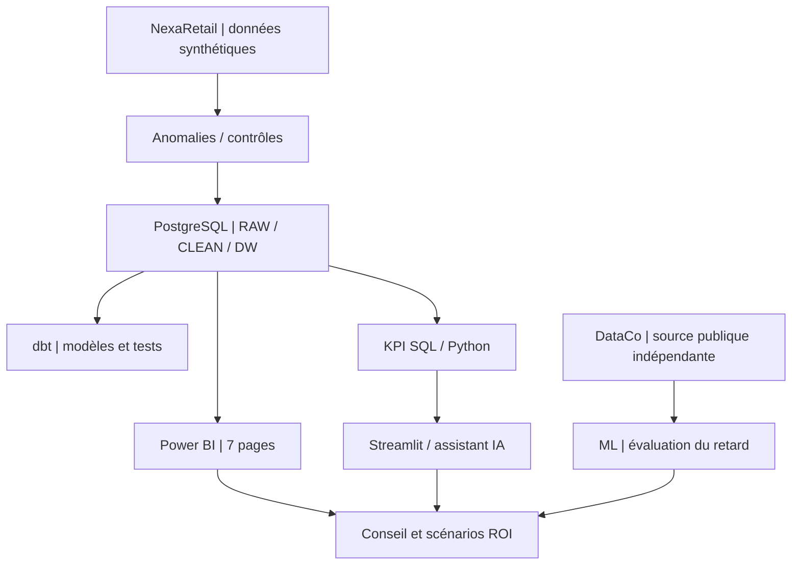

# 06 : Charte de mission : ConsultAI 360

> **PROJECT CHARTER / NEXARETAIL**  
> **Version :** cadrage initial 1.0, annoté pour lecture finale | **Validation :** simulée | **Entreprise :** fictive | **Pilotage :** projet individuel.

[← Périmètre](05_perimetre_projet.md) | [Index](INDEX.md) | [Roadmap initiale](feuille_de_route.md)

## Annexe de pilotage : registre de décisions

| Référence | Décision | Motif | Condition de réexamen |
|:--|:--|:--|:--|
| **DEC-01** | Utiliser NexaRetail synthétique | Tester des anomalies contrôlées | Disponibilité de données réelles autorisées |
| **DEC-02** | Conserver les lignes imparfaites | Éviter la disparition silencieuse d'activité | Présence d'une source fiable de correction |
| **DEC-03** | Utiliser DataCo pour le ML | Disposer d'une cible logistique exploitable | Données NexaRetail adaptées et étiquetées |
| **DEC-04** | Limiter l'IA à l'interprétation | Réduire le risque d'invention de KPI | Contrôles supplémentaires validés |
| **DEC-05** | Recommander un pilote | Mesurer la valeur avant généralisation | Résultats mesurés du pilote |

### Cadence de gouvernance proposée pour un pilote

| Moment | Revue | Question |
|:--|:--|:--|
| **Démarrage** | Périmètre et référentiels | Quels chiffres et sources font autorité ? |
| **Suivi régulier** | Qualité, incidents et adoption | Les utilisateurs disposent-ils d'informations fiables ? |
| **Mi-parcours** | Hypothèses de gains | Les effets attendus commencent-ils à être mesurables ? |
| **Clôture** | Valeur, risques et coût de maintien | Poursuivre, corriger ou arrêter ? |

Cette cadence est une **proposition méthodologique**, non une gouvernance déjà exécutée.

---
## Décision de cadrage

**Mission retenue :** démontrer, dans un environnement synthétique, une démarche de conseil reliant **fiabilisation des données → architecture analytique → pilotage → expérimentation IA → décision économique**.

> [!IMPORTANT]
> Cette charte documente une **décision pédagogique simulée**, et non un contrat ou une approbation émanant d'un client réel. Les budgets de temps sont des **prévisions initiales**, pas des heures certifiées.

| Paramètre | Référence |
|:--|:--|
| Organisation | NexaRetail : distribution omnicanale fictive |
| Commanditaire | Direction générale simulée |
| Réalisation | Projet individuel ConsultAI 360 |
| Budget de travail | **180 heures prévisionnelles** |
| Horizon de données | **24 mois** (hypothèse de cadrage) |
| Livrable décisionnel | Rapport final et recommandations de pilote |
| Principe de qualité | Traçabilité des calculs et limites explicites |

## 1. Justification de la mission

NexaRetail dispose, dans le scénario de travail, de **35 magasins**, **120 000 clients**, **450 employés** et **8 000 produits**. L'activité est distribuée entre magasins et e-commerce.

Le risque central est de produire des décisions à partir de données incomplètes ou de définitions contradictoires. La mission doit rendre visibles les erreurs, documenter leur impact analytique et tester les conditions d'une utilisation responsable de l'IA.

## 2. Objectifs et critères de valeur

| Objectif stratégique | Question de direction | Critère de démonstration |
|:--|:--|:--|
| **Fiabiliser** | Quelles données sont utilisables ? | Anomalies mesurées, exclusions visibles |
| **Consolider** | Quel chiffre fait autorité ? | Sources et granularités explicites |
| **Piloter** | Où agir en priorité ? | Dashboard et indicateurs cohérents |
| **Expérimenter** | Le ML apporte-t-il un signal ? | Évaluation indépendante, limites connues |
| **Encadrer l'IA** | Peut-on expliquer sans inventer ? | Calculs déterministes, garde-fous |
| **Décider** | Quel investissement tester ? | ROI hypothétique et pilote conditionnel |

## 3. Livrables et périmètre

| Workstream | Livrable | Frontière de responsabilité |
|:--|:--|:--|
| **Data Quality** | Jeux synthétiques, injections, audits | Pas de correction arbitraire sans source fiable |
| **Data Engineering** | PostgreSQL RAW/CLEAN/DW et dbt | Pas de garantie de déploiement automatisé |
| **BI** | Power BI, dictionnaire KPI | Indicateurs limités par la couverture des données |
| **Data Science** | Évaluation ML DataCo | Pas de généralisation à NexaRetail |
| **IA analytique** | Streamlit, assistant local, API documentée | Pas d'action autonome sur la base |
| **Stratégie** | Scénarios ROI, recommandations, rapport | Pas de gains financiers réellement constatés |

### Exclusions majeures

E-commerce réel, paiement opérationnel, infrastructure de production, application mobile, ERP/WMS complet, modèle ML déployé sur NexaRetail, LLM entraîné sur mesure et décisions automatisées.

## 4. Architecture de référence

Le diagramme représente des **composants documentés et leurs rôles analytiques** ; il ne garantit pas que tous les échanges soient automatisés en production.

## 5. Planning initial : base de référence

| Phase | Activité | Estimation |
|:--|:--|--:|
| 1 | Cadrage métier | 6 h |
| 2 | Génération synthétique | 10 h |
| 3 | Anomalies et Excel | 10 h |
| 4 | PostgreSQL et qualité | 15 h |
| 5 | Data Warehouse et dbt | 15 h |
| 6 | Power BI | 18 h |
| 7 | Machine Learning | 17 h |
| 8 | Streamlit et assistant IA | 24 h |
| 9 | ROI | 14 h |
| 10 | Stratégie | 8 h |
| 11 | Tests et documentation | 21 h |
| 12 | Rapport, présentation et GitHub | 22 h |
| **Total prévisionnel** | | **180 h** |

La [roadmap initiale](feuille_de_route.md) conserve ce découpage. L'évolution ultérieure du dashboard de quatre à **sept pages** illustre une modification de périmètre ; elle ne doit pas être réécrite rétroactivement comme une intention initiale.

## 6. Parties prenantes : simulation RACI simplifiée

| Acteur fictif | Responsabilité principale |
|:--|:--|
| Direction générale | Priorités, arbitrage et décision de pilote |
| Finance | Définitions financières et hypothèses ROI |
| Commercial | Analyse des ventes et des canaux |
| Logistique | Définition des retards et des populations évaluables |
| Service client | Interprétation des réclamations |
| Consultant Data & IA | Architecture, contrôles, analyses, restitution |

Il n'existe **aucun comité de pilotage réel** associé à cette étude de cas.

## 7. Registre de risques

| Risque | Conséquence | Mesure de maîtrise | Risque résiduel |
|:--|:--|:--|:--|
| Données manquantes | KPI incomplets | Mesure de couverture et conservation des anomalies | Décisions limitées par les sources |
| Références invalides | Mauvaise attribution | Contrôles de clés, membres « Inconnu » | Attribution non récupérable sans vérité terrain |
| Granularités confondues | Doubles comptes | Faits distincts, dictionnaire KPI | Mauvais usage possible par le lecteur |
| Fuite de cible ML | Performance artificielle | Exclusion des variables postérieures à la prédiction | Décalage entre jeux de données |
| Hallucination IA | Commentaire trompeur | Calculs SQL/Python, validation des réponses | Revue humaine requise |
| ROI trop optimiste | Mauvaise allocation de capital | Scénarios et limites documentées | Gains non observés |
| Reproductibilité incomplète | Reprise difficile | Guides, scripts, tests historiques | Environnement neuf non garanti |

## 8. Gouvernance des changements

Une demande d'évolution doit préciser **le besoin**, **les dépendances**, **le bénéfice attendu**, **le coût de réalisation**, **les contrôles nécessaires** et **l'impact documentaire**.

**Exemples de changements documentés :** extension Power BI à sept pages, sélection de DataCo pour le ML, ajout d'une API locale documentée, adoption de Streamlit/Ollama.

## 9. Conditions de réception

La réception documentaire exige des preuves **traçables**, et non une déclaration générale de succès : code versionné, définitions de KPI, rapports de tests datés, protocole ML, limites de l'IA et hypothèses ROI.

Le [bilan de validation](11_validation_reproductibilite.md) distingue tests historiques, validations de composants et absence de preuve de reconstruction intégrale.

### Décision finale de conseil

La recommandation documentée est un **pilote de 90 jours sous conditions**, avec **GO pour un pilote cadré** et **NO-GO pour une mise en production immédiate**. Il s'agit d'une recommandation dans le cas fictif, pas d'une autorisation de déploiement réelle.

## 10. Clôture du cadrage

La charte fixe une ambition : **démontrer une méthode de transformation responsable plutôt que simuler une entreprise déjà transformée**. Les résultats, changements et limites sont détaillés dans les livrables finaux.

---

[Rapport final de conseil](12_rapport_final_conseil.md) | [Bilan de validation](11_validation_reproductibilite.md) | [Retour à l'index](INDEX.md)
