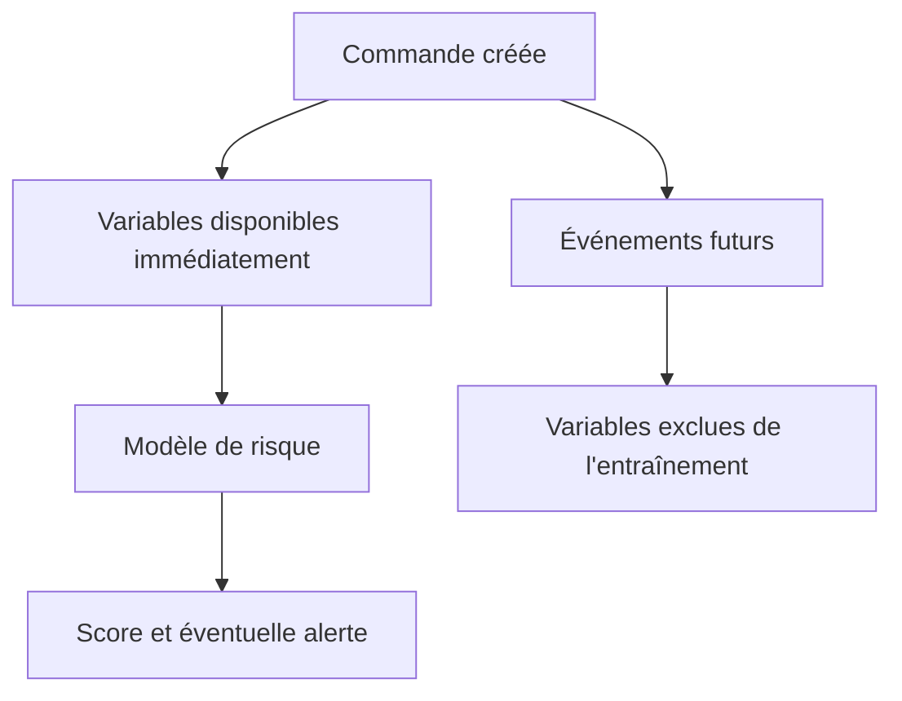

# 07 : Cadrage de la prédiction logistique

**CONSULTAI 360 | DOSSIER DE CONSEIL**

[Accueil du projet](../README.md) | [Sommaire documentaire](INDEX.md) | [Application Streamlit](https://consultai-360.streamlit.app/)

## 1. Contexte métier

Les retards d'expédition peuvent entraîner des coûts opérationnels, une dégradation de l'expérience client et une augmentation des réclamations.

L'objectif est d'identifier suffisamment tôt les commandes présentant un risque élevé de retard pour permettre aux équipes logistiques de prioriser leurs interventions.

## 2. Objectif Machine Learning

Développer un modèle de classification binaire permettant d'estimer la probabilité de retard d'expédition.

**Variable cible :** `Late_delivery_risk`

- 0 : absence de retard selon la définition du dataset
- 1 : retard selon la définition du dataset

## 3. Source

Dataset public : DataCo Smart Supply Chain for Big Data Analysis.

Ce dataset est indépendant des données synthétiques NexaRetail utilisées dans les étapes précédentes.

## 4. Moment de prédiction

La prédiction doit utiliser uniquement les informations disponibles au moment de la commande.

Les informations connues après l'expédition ou après la constatation du retard seront exclues.

## 5. Méthodologie

1. Audit de la qualité et de la structure du dataset.
2. Identification des doublons et du grain des données.
3. Vérification de la variable cible.
4. Recherche des risques de fuite de données.
5. Séparation chronologique des données.
6. Construction d'une baseline.
7. Entraînement de modèles de classification.
8. Évaluation avec ROC-AUC, PR-AUC, précision, rappel, F1 et matrice de confusion.
9. Analyse des facteurs prédictifs.
10. Suivi des expériences avec MLflow.

## 6. Critères de réussite

- Pipeline reproductible.
- Absence de fuite de données identifiée dans les variables retenues.
- Performance comparée à une baseline.
- Évaluation sur des données chronologiquement postérieures à l'entraînement.
- Interprétation métier des résultats.
- Limites et hypothèses documentées.

## 7. Limites

Le dataset ne contient pas de véritable date de livraison finale permettant de mesurer directement le retard du dernier kilomètre.

Les performances du modèle ne démontreront donc pas, à elles seules, sa capacité à prédire les retards de livraison chez NexaRetail.

Les recommandations opérationnelles et les éventuels gains financiers seront présentés comme des simulations, sauf preuve empirique contraire.

---

## Cadre de décision métier

Le modèle ne doit pas simplement classer les commandes. Il doit permettre de **prioriser des vérifications opérationnelles** à un moment où une intervention est encore possible.

| Question | Réponse de cadrage |
|---|---|
| Quelle décision ? | Sélectionner les commandes à examiner en priorité |
| Quand ? | À la création de la commande, avant les événements futurs |
| Quel résultat ? | Score de risque et alerte selon un seuil documenté |
| Quel coût ? | Faux positifs à traiter, faux négatifs non détectés |
| Quelle référence ? | Règle simple fondée sur le mode d'expédition |
| Quelle limite ? | Une alerte ne prouve pas qu'une intervention évite le retard |

### Le grain des données : un point essentiel

DataCo contient **180 519 lignes d'articles** pour **65 752 commandes uniques**. Une évaluation naïve ligne par ligne pourrait donner trop de poids aux commandes comportant plusieurs articles. Le protocole final doit donc être lu **au niveau commande**, avec séparation des groupes de commandes entre les jeux.

### Variables à risque de fuite

| Variable | Risque | Décision |
|---|---|---|
| `Delivery Status` | Révèle une issue postérieure | Exclure |
| `Days for shipping (real)` | Durée réelle inconnue à la commande | Exclure |
| Date réelle d'expédition | Information future | Exclure |
| Mode d'expédition | Disponible à la commande, mais très structurant | Conserver sous réserve d'analyse de robustesse |

### Conditions avant un usage réel

Une validation sur une autre période, une analyse de calibration, des coûts d'intervention, un suivi des dérives et une validation sur la population cible seraient nécessaires. La cible DataCo ne doit jamais être présentée comme un retard final de livraison chez NexaRetail.

## Formulation exacte du problème

La question étudiée est : **peut-on estimer, à partir des informations disponibles au moment de la commande, le risque de retard défini dans DataCo ?**

Il s'agit d'une **classification binaire supervisée**. La variable cible distingue les commandes avec risque de retard selon la définition du dataset. La décision métier potentielle serait de sélectionner certaines commandes pour examen, mais aucune intervention réelle n'est mesurée dans le projet.

### Pourquoi agréger au niveau commande ?

Le fichier source comporte **180 519 lignes** pour **65 752 commandes**. Les articles d'une même commande partagent des informations logistiques. Une séparation aléatoire des lignes peut laisser des articles de la même commande à la fois dans l'entraînement et dans le test, créant une évaluation trompeuse.

| Choix | Conséquence |
|---|---|
| Séparation des lignes | Risque de fuite entre articles d'une même commande |
| Séparation des commandes | Une commande appartient à une seule partition |
| Séparation temporelle | Teste davantage le comportement sur une période future |
| Variables postérieures exclues | Respecte le moment réel de prédiction |

## Protocole d'évaluation à documenter

1. Identifier la commande et la cible.
2. Retirer les variables indisponibles au moment de la décision.
3. Constituer des partitions sans recouvrement de commandes.
4. Construire une règle de référence simple.
5. Entraîner et sélectionner le modèle sur les données autorisées.
6. Choisir le seuil sur la validation, sans optimiser sur le test final.
7. Comparer rappel, précision, F1, AUC et matrice de confusion.
8. Présenter les limites de transfert vers une autre entreprise.

## Risques spécifiques

**Décalage de population :** DataCo ne représente pas nécessairement NexaRetail. **Décalage temporel :** les pratiques logistiques évoluent. **Coût des alertes :** un faux positif peut déclencher un travail inutile. **Disponibilité des variables :** une variable utile à l'entraînement peut être absente lors de l'usage.

Ces risques justifient un statut d'expérience analytique plutôt qu'un produit prêt à déployer.

## Disponibilité des variables

<strong>Le piège de la fuite de données</strong>

Une durée d'expédition réelle ou un statut de livraison constaté après la commande ne peut pas servir à prédire un risque au moment de la commande. Le modèle paraîtrait performant en utilisant une information inaccessible lors de la décision.

---

[Chapitre précédent](06_charte_projet.md) | [Sommaire](INDEX.md) | [Chapitre suivant](08_rapport_final_prediction.md)
