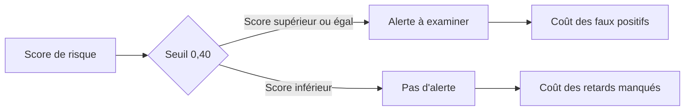

# 08 : Évaluation du modèle prédictif DataCo

**CONSULTAI 360 | DOSSIER DE CONSEIL**

[Accueil du projet](../README.md) | [Sommaire documentaire](INDEX.md) | [Application Streamlit](https://consultai-360.streamlit.app/)

## Résumé exécutif

Problème : prédire le **risque de retard d'expédition** d'une commande DataCo à partir des informations disponibles au moment de la commande. Le jeu de données ne permet pas de vérifier la date de livraison finale au client.

**Modèle retenu avant test :** Random Forest (120 arbres, minimum 15 observations par feuille, `max_features=sqrt`, graine 17). **Seuil fixé avant test : 40 %.**

## Protocole

- Train : 46,026 commandes ; validation : 9,863 ; test indépendant : 9,863.
- Sélection du modèle et du seuil réalisée sur validation uniquement.
- Réentraînement sur train + validation, puis **une seule évaluation** sur test.
- Aucune variable postérieure à la commande (`Days for shipping (real)`, `Delivery Status`, date d'expédition réelle, etc.) utilisée.

## Résultats du test final

| Modèle | ROC-AUC | PR-AUC | Précision | Rappel | F1 | Faux positifs | Faux négatifs |
|---|---:|---:|---:|---:|---:|---:|---:|
| Baseline mode d'expédition | 0.729 | 0.750 | 0.802 | 0.587 | 0.678 | 787 | 2242 |
| Random Forest | 0.761 | 0.819 | 0.659 | 0.777 | 0.713 | 2184 | 1213 |

Le seuil de 40 % est une **hypothèse de décision opérationnelle** et non un optimum financier prouvé. Les résultats par mode d'expédition figurent dans `reports/ml/final_evaluation/final_by_shipping_mode.csv` (sortie locale non versionnée).

## Lecture métier

Le modèle peut servir à **prioriser l'examen** des commandes présentant un risque de retard d'expédition. Une alerte ne prouve pas qu'une action préventive évitera le retard. Le coût des alertes et celui des retards manqués doivent être validés avec un client avant toute décision de déploiement.

## Limites et risques

1. **Cible :** `Late_delivery_risk` n'est pas une preuve de retard de livraison finale.
2. **Dominance du mode d'expédition :** l'importance par permutation sur validation était de 0,2577 de ROC-AUC pour `shipping_mode`, contre 0,0473 pour `order_hour`. Risque de dépendance à une règle structurelle du dataset.
3. **Étiquetage :** commandes annulées ou suspectées de fraude étiquetées sans retard ; définition métier à clarifier.
4. **Transférabilité :** aucun résultat ne prouve une généralisation aux données synthétiques NexaRetail.
5. **ROI :** simulations de coûts d'erreurs, pas économies réalisées ni effet causal démontré.
6. **Validation :** découpage chronologique, mais une seule période de test ; vérifier stabilité, calibration, dérive et équité avant production.

## Recommandation consultant

**Prototype analytique / démonstration de faisabilité**, non déploiement automatique. Confronter le modèle à une règle simple basée sur le mode d'expédition, mesurer les interventions réelles et leur efficacité, puis piloter un test terrain avant d'annoncer un ROI.

## Reproductibilité

Script : `src/ml/final_evaluation_dataco.py`. Jeu de test identifié par SHA-256 dans `reports/ml/final_evaluation/final_metadata.json` (local). Historique d'expériences MLflow local. Les CSV bruts et les données intermédiaires ne sont pas publiés.

---

## Tableau de lecture des compromis

| Critère | Baseline | Random Forest | Lecture métier |
|---|---:|---:|---|
| ROC-AUC | 0,729 | **0,761** | Meilleure discrimination globale sur le test |
| PR-AUC | 0,750 | **0,819** | Meilleure qualité du classement précision-rappel |
| Précision | **0,802** | 0,659 | Plus d'alertes non confirmées pour le modèle |
| Rappel | 0,587 | **0,777** | Davantage de retards détectés |
| F1 | 0,678 | **0,713** | Compromis global amélioré |
| Faux négatifs | 2 242 | **1 213** | 1 029 retards de moins non signalés |
| Faux positifs | **787** | 2 184 | 1 397 alertes supplémentaires |

Les différences de comptage décrivent les **résultats du test DataCo**, et non un gain opérationnel mesuré. Les seuils et politiques d'alerte doivent être comparés avec leurs coûts respectifs.

## Fiche de décision avant déploiement

**Décision actuelle :** conserver un prototype analytique.

**Expérience suivante recommandée :** comparer une règle simple et le Random Forest sur une période indépendante, instrumenter le nombre d'alertes, le temps de traitement et les interventions réellement efficaces.

**Conditions d'arrêt :** coût des faux positifs excessif, performance instable selon les périodes, variables indisponibles au moment de la décision ou absence de bénéfice mesurable.

## Transparence des résultats

Les **65 752 commandes** proviennent d'un dataset de **180 519 lignes**. Les partitions finales contiennent **46 026 commandes d'entraînement**, **9 863 de validation** et **9 863 de test**. La séparation temporelle et le contrôle des fuites sont essentiels, mais une seule fenêtre de test ne suffit pas à garantir la robustesse future.

## Lecture approfondie des résultats

Les résultats doivent être interprétés ensemble. La ROC-AUC mesure la capacité du score à classer les observations sur différents seuils. Le rappel et la précision décrivent le comportement au seuil retenu. Le F1 combine ces deux dernières métriques, mais ne représente pas un coût financier.

| Indicateur | Baseline | Random Forest | Écart en points |
|---|---:|---:|---:|
| ROC-AUC | 72,9 % | 76,1 % | +3,2 |
| PR-AUC | 75,0 % | 81,9 % | +6,9 |
| Précision | 80,2 % | 65,9 % | -14,3 |
| Rappel | 58,7 % | 77,7 % | +19,0 |
| F1 | 67,8 % | 71,3 % | +3,5 |

Les valeurs arrondies servent à comparer les modèles. Le tableau de résultats précédent conserve les chiffres détaillés.

### Interprétation opérationnelle

Le Random Forest détecte davantage de retards potentiels, mais signale aussi plus de commandes qui ne correspondent pas à la classe positive. Si une intervention est coûteuse, la précision peut devenir prioritaire. Si un retard manqué coûte très cher, le rappel peut recevoir davantage de poids.

### Pourquoi ne pas conclure sur l'impact financier ?

Une matrice de confusion décrit les erreurs de classification. Elle ne dit pas combien de retards auraient été évités par une intervention. Pour estimer une valeur, il faudrait mesurer la proportion d'alertes actionnables, l'efficacité des interventions, leur coût et l'évolution des retards dans un protocole approprié.

## Vérifications complémentaires recommandées

- Calibration : un score annoncé de 70 % correspond-il à une fréquence proche de 70 % ?
- Stabilité : les performances se maintiennent-elles sur plusieurs périodes ?
- Segments : certains modes d'expédition sont-ils systématiquement moins bien prédits ?
- Référence : le gain persiste-t-il face à une règle simple ?
- Exploitation : combien d'alertes une équipe peut-elle réellement traiter ?

Ces analyses sont des **prolongements recommandés**, pas des résultats prétendument déjà validés.

## Arbitrage des alertes

<strong>Pourquoi le rappel ne suffit pas</strong>

Sur le test DataCo, le Random Forest réduit les faux négatifs par rapport à la baseline, mais génère davantage de faux positifs. Sans coût d'intervention mesuré, ce compromis ne prouve pas une rentabilité supérieure.

---

[Chapitre précédent](07_problematique_prediction.md) | [Sommaire](INDEX.md) | [Chapitre suivant](09_documentation_api.md)
