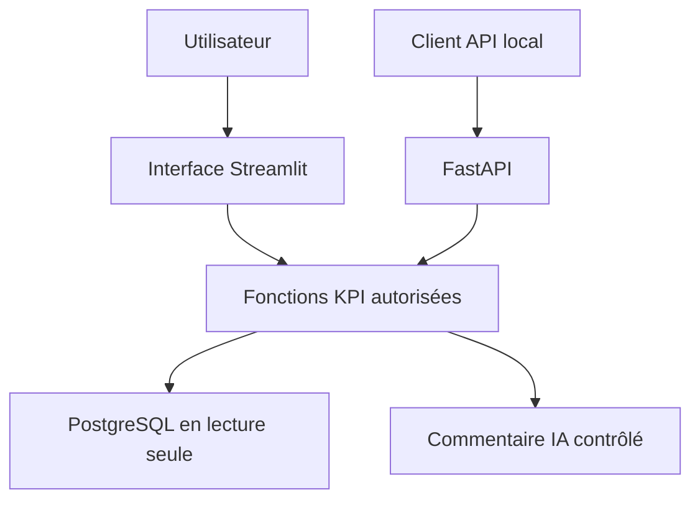

# 09 : Guide de l'API FastAPI et de la démonstration

<div align="center">

**CONSULTAI 360 | DOSSIER DE CONSEIL**

[Accueil du projet](../README.md) | [Sommaire documentaire](INDEX.md) | [Application Streamlit](https://consultai-360.streamlit.app/)

</div>


## Objectif

L'API locale expose des indicateurs de NexaRetail sans importer l'interface Streamlit. **Implémentation de référence :** `api/main.py`. L'ancien prototype de l'étape 9 est conservé uniquement dans `docs/archives/09_ancienne_proposition_api.md`.

## Points d'accès

| Méthode | Chemin | Réponse |
|---|---|---|
| GET | `/health` | `{"status": "ok"}` |
| GET | `/scenarios` | Liste des scénarios `low`, `medium`, `critical` |
| GET | `/kpis/{scenario}` | Indicateurs du scénario demandé |

Le nom de scénario est normalisé en minuscules. Un scénario inconnu renvoie HTTP 404.

## Modes de fonctionnement

- `CONSULTAI_DEMO_MODE=true` : réponses de démonstration, avec `scenario`, `orders`, `missing`, `missing_pct` et `source="demo"`.
- `CONSULTAI_DEMO_MODE=false` ou variable absente : lecture PostgreSQL via `src.assistant.kpi`, avec les indicateurs logistiques supplémentaires et `source="postgresql"`.

**Attention : le mode démonstration est désactivé par défaut dans le code actuel.** Sans connexion PostgreSQL disponible, `/kpis/{scenario}` peut répondre HTTP 503. La structure de réponse diffère entre les deux modes : aucun schéma Pydantic commun n'est déclaré dans l'implémentation actuelle.

## Sécurité et limites

- L'API ne génère pas de SQL à partir d'un modèle de langage.
- Les erreurs internes de lecture sont masquées derrière un message HTTP 503.
- Le code actuel intercepte largement les exceptions ; ce choix simplifie l'interface publique mais réduit le diagnostic côté appelant.
- Aucune authentification ni limitation de débit n'est implémentée dans `api/main.py` : ne pas présenter cette API comme prête pour une exposition publique.
- Les données de démonstration ne doivent pas être présentées comme des mesures issues de PostgreSQL.

## Validation

Les tests existants se trouvent notamment dans `tests/test_api_step9.py` et `tests/test_api_postgres_step9.py`. Le bilan consolidé de l'étape 11 est dans [la validation et reproductibilité](11_validation_reproductibilite.md). La mise à jour de ce document n'a pas réexécuté les tests.

---

## Accès à la démonstration Streamlit

**Application publique communiquée par le porteur du projet :** [Ouvrir ConsultAI 360 sur Streamlit](https://consultai-360.streamlit.app/).

Ce lien concerne **l'interface Streamlit** et ne constitue pas une URL publique de l'API FastAPI. La disponibilité instantanée de l'application, sa configuration d'hébergement et son accès éventuel à PostgreSQL n'ont pas été vérifiés dans cette mise à jour documentaire.

## Exemple de parcours d'utilisation de l'API locale

```bash
# Vérifier que le service local répond
curl http://127.0.0.1:8000/health

# Consulter les scénarios pris en charge
curl http://127.0.0.1:8000/scenarios

# Consulter les KPI du scénario medium
curl http://127.0.0.1:8000/kpis/medium
```

Ces exemples supposent que l'API est **déjà lancée localement sur le port 8000**. Ils ne démarrent pas le service.

### Contrat de réponse et erreurs

| Situation | Comportement documenté |
|---|---|
| `GET /health` | Réponse de santé `{"status":"ok"}` |
| Scénario inconnu | HTTP 404 |
| PostgreSQL indisponible hors mode démo | HTTP 503 possible |
| Mode démo activé | Données illustratives avec `source="demo"` |
| Mode PostgreSQL | Indicateurs issus de la couche KPI avec `source="postgresql"` |

### Points de vigilance pour un futur service public

Authentification, limitation de débit, schéma de réponse commun, journalisation contrôlée, gestion des secrets, observabilité et tests d'intégration réels restent nécessaires. **La présence d'une application Streamlit en ligne ne prouve pas que l'API est exposée ou sécurisée.**


## Architecture des accès



[Consulter la démonstration Streamlit](https://consultai-360.streamlit.app/)

<details><summary><strong>Mode démonstration et données PostgreSQL</strong></summary>

L'API peut retourner des valeurs de démonstration lorsque le mode correspondant est activé. Le champ de provenance doit être consulté avant de réutiliser un chiffre. Le lien Streamlit ne constitue pas une preuve de disponibilité publique de l'API.

</details>

---

[Chapitre précédent](08_rapport_final_prediction.md) | [Sommaire](INDEX.md) | [Chapitre suivant](10_rapport_power_bi.md)
