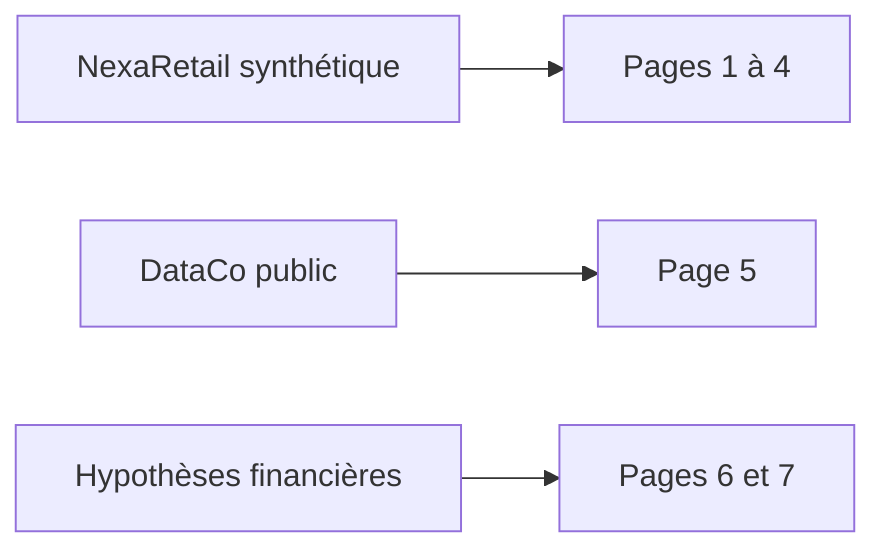

# 10 : Power BI, lecture métier et conception du dashboard

**CONSULTAI 360 | DOSSIER DE CONSEIL**

[Accueil du projet](../README.md) | [Sommaire documentaire](INDEX.md) | [Application Streamlit](https://consultai-360.streamlit.app/)

## 1. Objectif

Concevoir un tableau de bord décisionnel de sept pages permettant d'analyser les performances commerciales, logistiques et la qualité des données, puis de présenter une évaluation de modèle prédictif, des scénarios financiers et des recommandations opérationnelles.

## 2. Architecture

Le rapport repose sur trois ensembles distincts :

- **NexaRetail** : données commerciales et logistiques synthétiques, préparées dans PostgreSQL.
- **DataCo** : dataset public utilisé pour évaluer un modèle de prédiction des retards de livraison.
- **Simulations ROI** : hypothèses financières illustratives permettant d'explorer plusieurs scénarios de gains.

Les résultats de ces trois ensembles ne doivent pas être interprétés comme provenant d'une même population statistique.

## 3. Structure du dashboard

### Page 1 : Vue générale

Présentation des principaux indicateurs de performance : nombre de commandes, chiffre d'affaires, panier moyen, part des ventes en ligne et taux de retard.

### Page 2 : Performance commerciale

Analyse des ventes selon les magasins, les canaux et les dimensions disponibles dans le modèle décisionnel.

### Page 3 : Performance logistique

Analyse des expéditions, des retards et des différences de performance entre modes de livraison.

### Page 4 : Qualité des données

Présentation des anomalies, des valeurs manquantes et des indicateurs de fiabilité des données.

### Page 5 : Analyse IA et prédictions

Évaluation du modèle Random Forest entraîné sur DataCo.

| Indicateur | Résultat |
|---|---:|
| ROC-AUC | 76,05 % |
| Recall | 77,66 % |
| Precision | 65,88 % |
| F1-score | 71,29 % |
| Seuil de classification | 0,40 |

La page présente également la matrice de confusion, l'analyse des seuils, l'importance des variables et les performances selon le mode de livraison.

**Limite :** les exports de l'analyse des seuils et de l'évaluation finale doivent être distingués tant que leur provenance exacte n'est pas réconciliée.

### Page 6 : Impact financier et ROI

Simulation de trois scénarios avec un investissement initial de 50 000 €.

| Scénario | Gains annuels | Gain net | ROI net |
|---|---:|---:|---:|
| Prudent | 68 250 € | 18 250 € | 36,5 % |
| Central | 105 000 € | 55 000 € | 110 % |
| Optimiste | 147 000 € | 97 000 € | 194 % |

Les gains sont répartis entre optimisation logistique, réduction des anomalies et productivité opérationnelle.

Ces montants sont des **hypothèses de simulation**, non des économies effectivement observées.

### Page 7 : Recommandations stratégiques

Plan pilote de 90 jours comprenant cinq actions :

1. Réduire les retards de livraison.
2. Fiabiliser les données.
3. Tester les alertes prédictives.
4. Mesurer les économies réelles.
5. Décider du déploiement.

La décision proposée est de tester le dispositif avant une généralisation.

## 4. Méthodes techniques

- Modélisation décisionnelle dans PostgreSQL.
- Importation et transformation des données avec Power Query.
- Création de mesures et de tables calculées DAX.
- Gestion des filtres et scénarios.
- Construction de visualisations interactives.
- Présentation de résultats ML provenant d'exports CSV.
- Versionnement du rapport et de ses captures sur GitHub.

## 5. Difficultés rencontrées

- Importation de nombres décimaux interprétés comme des entiers.
- Gestion des paramètres régionaux et des séparateurs décimaux.
- Mauvaise reconnaissance des en-têtes CSV.
- Confusion entre mesures DAX et tables calculées.
- Filtrage nécessaire des résultats par modèle ML.
- Vérification de la cohérence des matrices de confusion.
- Correction du calcul du délai de retour sur investissement.
- Limitations de mise en forme des mesures textuelles DAX.
- Difficultés d'installation de visuels personnalisés.
- Gestion des fichiers Power BI et des caches temporaires dans Git.
- Nécessité de distinguer données observées, résultats ML et simulations.

## 6. Limites

Les données NexaRetail sont synthétiques. Les performances du modèle DataCo ne constituent pas une validation sur les données NexaRetail. Les gains financiers sont simulés et nécessitent une vérification sur un pilote opérationnel.

## 7. Livrables

- Rapport Power BI `.pbix`.
- Rapport PDF.
- Captures d'écran des différents scénarios.
- Documentation technique et métier.
- Fichiers du projet Power BI versionnés sur GitHub.

## 8. Conclusion

Cette étape transforme les résultats analytiques du projet en un support d'aide à la décision. Elle associe reporting opérationnel, évaluation de modèle prédictif, simulation financière et plan d'action, tout en distinguant les résultats mesurés des hypothèses.

---

## Consulter les livrables

- [Application ConsultAI 360 sur Streamlit](https://consultai-360.streamlit.app/) : interface complémentaire, distincte du rapport Power BI.
- [Rapport de conseil](12_rapport_final_conseil.md) : interprétation métier et décisions proposées.
- [Dictionnaire KPI](04_dictionnaire_indicateurs.md) : périmètres, dénominateurs et limites.
- [Bilan de validation](11_validation_reproductibilite.md) : ce qui a été vérifié et ce qui reste à confirmer.

### Guide de lecture des sept pages

| Page | Question à laquelle répondre | Point de contrôle |
|---|---|---|
| 1. Vue générale | Quelle est la situation d'ensemble ? | Scénario et définition des cartes |
| 2. Ventes | Où se concentre l'activité ? | Attribution magasin et canal |
| 3. Logistique | Où les retards sont-ils les plus fréquents ? | Population des expéditions évaluables |
| 4. Qualité | Quels indicateurs sont fragilisés ? | Nature et unité des anomalies |
| 5. ML | Quel signal prédictif DataCo fournit-il ? | Population indépendante et seuil 0,40 |
| 6. ROI | Quels gains hypothétiques justifieraient un pilote ? | Coûts inclus et exclusions |
| 7. Stratégie | Que tester en premier ? | Mesures avant/après et critères d'arrêt |

### Choix de conception visuelle

Le rapport suit une identité **bleu marine, doré et fond clair**, avec navigation latérale et organisation cohérente des indicateurs. La présentation ne doit toutefois jamais masquer les limites des données. La cohérence graphique est un objectif de restitution, pas une preuve de validité des calculs.

### Vérifications à réaliser lors d'une prochaine ouverture du PBIX

Confirmer les sources actives, le modèle de relations, les mesures DAX, les filtres de scénario et la concordance des exports ML. Ces contrôles sont proposés comme **checklist documentaire**, sans prétendre qu'ils ont été réexécutés aujourd'hui.

## Trois sources, trois lectures

<strong>Pourquoi ne pas fusionner ces résultats ?</strong>

Les pages commerciales décrivent NexaRetail, la page prédictive restitue une expérience indépendante sur DataCo et les pages financières utilisent des hypothèses de simulation. Ces ensembles ne représentent pas la même population ni le même type de preuve.

[Voir aussi la démonstration Streamlit](https://consultai-360.streamlit.app/)

---

[Chapitre précédent](09_documentation_api.md) | [Sommaire](INDEX.md) | [Chapitre suivant](11_validation_reproductibilite.md)
