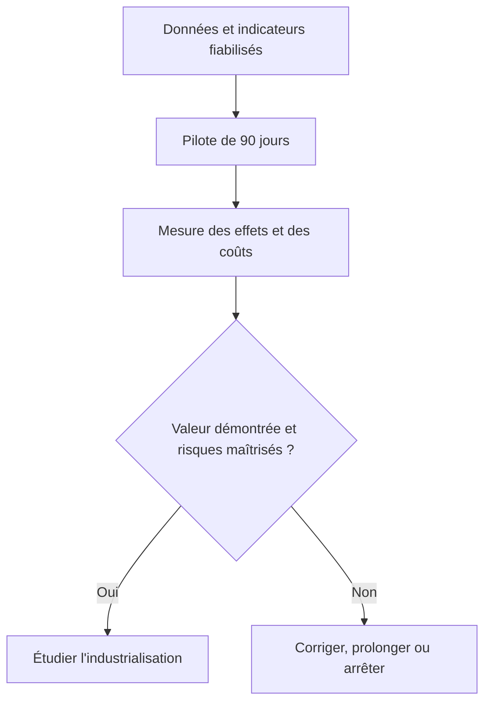

# 12 : Rapport final de conseil Data & IA

**CONSULTAI 360 | DOSSIER DE CONSEIL**

[Accueil du projet](../README.md) | [Sommaire documentaire](INDEX.md) | [Application Streamlit](https://consultai-360.streamlit.app/)

**Client fictif : NexaRetail | Version de synthèse : novembre 2026**

> Cas d'étude de conseil sur données synthétiques. Les performances ML proviennent du jeu public distinct DataCo. Les gains financiers sont des hypothèses, non des résultats observés.

## 1. Synthèse exécutive
ConsultAI 360 illustre une mission de transformation Data & IA : construire des scénarios de dégradation de données, structurer un entrepôt PostgreSQL, tester des transformations dbt, restituer les indicateurs dans Power BI, évaluer un prototype prédictif distinct et proposer un pilote opérationnel. La priorité recommandée est la **fiabilisation des données et la mesure de résultats sur un pilote**, avant toute industrialisation.

### Constats principaux
- **CA de référence NexaRetail ORIGINAL : 72 056 406,60 €**, pour 120 000 commandes.
- CA observé après dégradation simulée : **LOW 71 327 494,22 € (−1,01 %)** ; **MEDIUM 68 448 127,94 € (−5,01 %)** ; **CRITICAL 64 901 512,00 € (−9,93 %)**.
- En CRITICAL, le CA mesuré est inférieur de **7 154 894,60 €** à la référence. Il s'agit d'une **sous-estimation de l'indicateur observé**, et non d'une perte commerciale réelle.
- Les anomalies de références et de dates sont conservées et mesurées, plutôt que masquées par suppression arbitraire.
- Les tests Python exécutés le 10/11/2026 ont donné **31/31 réussis** ; dernier build dbt **53/53 PASS**, résultat historique documenté, non rejoué pendant l'étape 11.

## 2. Contexte, enjeux et objectifs
NexaRetail est une entreprise omnicanale fictive. Les enjeux simulés concernent la qualité des données transactionnelles, la visibilité sur les ventes, la performance logistique et la capacité à orienter des décisions avec des preuves fiables.

**Objectifs de mission :** établir une source analytique contrôlée ; mesurer les effets de la dégradation des données sur les KPI ; fournir un tableau de bord décisionnel ; explorer la faisabilité d'une prédiction de risque logistique ; formuler une stratégie et des hypothèses de retour sur investissement.

## 3. Architecture et méthode
1. **Génération synthétique NexaRetail** : scénarios ORIGINAL, LOW, MEDIUM, CRITICAL ; données clients, produits, commandes, paiements, expéditions, stocks, réclamations.
2. **PostgreSQL** : RAW → CLEAN → DW. CLEAN signifie typé et contrôlé, non exempt d'anomalies. Les faits conservent leurs granularités distinctes.
3. **dbt** : staging, intermediate, marts, tests et documentation du lineage. Les jointures tiennent compte du scénario.
4. **Power BI** : sept pages de pilotage commercial, logistique, qualité, résultats ML, ROI et recommandations.
5. **DataCo ML** : source publique **indépendante**, utilisée pour évaluer un Random Forest de risque de retard d'expédition.
6. **FastAPI, Streamlit et assistant IA** : consultation des KPI, règles métier et commentaires contrôlés ; aucun SQL exécutable généré par le LLM.
7. **Analyse financière** : scénarios hypothétiques, sans mesure d'impact causal sur une entreprise réelle.

## 4. Diagnostic de qualité et résultats analytiques
| Scénario | Commandes de référence analytique | CA mesuré | Écart vs ORIGINAL |
|---|---:|---:|---:|
| ORIGINAL | 120 000 | 72 056 406,60 € | : |
| LOW | 120 000 | 71 327 494,22 € | −728 912,38 € (−1,01 %) |
| MEDIUM | 120 000 | 68 448 127,94 € | −3 608 278,66 € (−5,01 %) |
| CRITICAL | 120 000 | 64 901 512,00 € | −7 154 894,60 € (−9,93 %) |

*Ces valeurs sont celles du rapport analytique SQL de référence. Les volumes RAW des scénarios diffèrent du nombre de commandes utilisé dans cette comparaison ; ne pas confondre les deux périmètres.*

Anomalies identifiées dans les scénarios dégradés : références clients inconnues, produits inconnus, paiements sans commande rattachable et dates manquantes. La somme de **82 953** concerne des **lignes affectées dans trois tables** ; elle ne représente pas 82 953 transactions uniques. Les dates manquantes sont une catégorie supplémentaire dont les recouvrements doivent être examinés.

**Implication métier :** une qualité de données insuffisante dégrade la fiabilité des indicateurs, l'attribution des ventes et la capacité à prioriser les interventions. Il ne faut pas assimiler cette dégradation de mesure à une perte économique constatée.

## 5. Restitution Power BI
Le tableau de bord comprend :
1. Vue globale : commandes, CA, panier moyen, canal online, retards.
2. Performance commerciale : magasins, canaux et segmentation.
3. Logistique : expéditions, modes et retards.
4. Qualité des données : anomalies, valeurs manquantes et couverture.
5. IA & prédictions : résultats de l'expérience DataCo.
6. ROI : trois scénarios de gains hypothétiques.
7. Recommandations : actions prioritaires et pilote de 90 jours.

Les pages 5 et 6 ne constituent pas des mesures opérationnelles sur les mêmes transactions que les pages NexaRetail.

## 6. Expérience Machine Learning : DataCo
**Problème :** classification du risque de retard d'expédition à partir de données publiques DataCo.

| Métrique finale documentée | Résultat |
|---|---:|
| ROC-AUC | 76,05 % |
| Rappel | 77,66 % |
| Précision | 65,88 % |
| F1-score | 71,29 % |
| Seuil de classification | 0,40 |

Le modèle démontre une capacité de discrimination sur le jeu de test DataCo, **pas** une performance prouvée sur NexaRetail. La cible `Late_delivery_risk` et le poids du mode d'expédition imposent une prudence métier. La provenance des exports de seuil et d'évaluation finale doit être réconciliée avant d'affirmer qu'ils décrivent une expérience identique. Une comparaison avec une règle simple, une validation temporelle complémentaire et un test terrain sont recommandés avant déploiement.

## 7. Scénarios financiers : hypothèses de ROI
Hypothèse commune : **investissement initial de 50 000 €**.

| Scénario | Gains annuels hypothétiques | Gain net hypothétique | ROI net simulé |
|---|---:|---:|---:|
| Prudent | 68 250 € | 18 250 € | 36,5 % |
| Central | 105 000 € | 55 000 € | 110 % |
| Optimiste | 147 000 € | 97 000 € | 194 % |

Formule : `ROI net = (gains annuels supposés − investissement initial) / investissement initial`. Ces chiffres ne sont **ni des gains réalisés ni une preuve d'effet causal**. Leur validité dépend d'un pilote mesurant les coûts, les interventions et les résultats réels.

## 8. Recommandations stratégiques
| Priorité | Initiative | Justification | Indicateur de suivi |
|---|---|---|---|
| 1 | Définir les propriétaires des données et les KPI de référence | Réduire les écarts de définition et d'attribution | Taux de complétude, taux de références invalides |
| 2 | Mettre en place des contrôles automatisés à chaque chargement | Détecter tôt les anomalies | Nombre de tests échoués, délai de résolution |
| 3 | Piloter les retards de livraison | Relier logistique et décisions | Taux de retard, délai par mode |
| 4 | Expérimenter des alertes prédictives | Évaluer la valeur ajoutée du ML | Précision, rappel, faux positifs, coût d'intervention |
| 5 | Mesurer le ROI observé du pilote | Arbitrer l'industrialisation | Gains vérifiés, coûts totaux, ROI réalisé |

### Plan de mise en œuvre recommandé
**Jours 1–30 : cadrage et fiabilisation.** Valider les définitions de KPI, les responsables, les règles de contrôle et les sources de vérité ; constituer un état initial.

**Jours 31–60 : pilote ciblé.** Tester les alertes logistiques sur un périmètre limité, avec une règle simple comme référence ; tracer les interventions et les coûts.

**Jours 61–90 : évaluation et décision.** Comparer les résultats observés au témoin pertinent, mesurer les faux positifs et les gains réels, décider de poursuivre, ajuster ou arrêter.

**Horizon 3–12 mois (conditionnel) :** industrialisation progressive, monitoring qualité et modèle, gouvernance des accès et processus de revue.

## 9. Risques, limites et conditions de passage à l'échelle
- NexaRetail est **entièrement fictif** et les anomalies sont simulées.
- DataCo est **indépendant** de NexaRetail ; aucune validation croisée n'est démontrée.
- Les montants de CA sous-estimés ne sont pas des pertes de trésorerie.
- Le ROI est hypothétique et doit être mesuré dans un pilote.
- Les 31 tests Python ont été exécutés avec succès ; les résultats dbt/SQL et les validations d'applications sont historiques.
- Les tests API avec PostgreSQL simulé ne remplacent pas des tests d'intégration réels.
- La reconstruction intégrale sur une machine vierge n'est pas démontrée ; données et certains artefacts ML restent locaux.
- La documentation Power BI ne garantit pas une vérification visuelle complète de chaque page à la date de ce rapport.

**Décision recommandée :** poursuivre en **preuve de concept / pilote instrumenté**, sans annoncer de déploiement industriel ni de ROI réalisé.

## 10. Conclusion
ConsultAI 360 relie Data Engineering, Data Quality, Analytics, BI, Machine Learning, API et IA autour d'un raisonnement de consultant : **diagnostic → preuve → limites → recommandation → mesure de l'impact**. Sa valeur principale est la traçabilité de la démarche, non la promesse de résultats commerciaux réels.

## 11. Références internes
- [Rapport Data Engineering & Analytics](../rapports/01_Rapport_Data_Engineering_Analytics.pdf)
- [Rapport ML final](08_rapport_final_prediction.md)
- [Documentation API](09_documentation_api.md)
- [Documentation Power BI](10_rapport_power_bi.md)
- [Bilan de validation et reproductibilité](11_validation_reproductibilite.md)
- [README du dépôt](../README.md)

---

## Accès aux démonstrations et aux preuves

**Démonstration interactive :** [ConsultAI 360 sur Streamlit](https://consultai-360.streamlit.app/). L'URL a été fournie par le porteur du projet ; son fonctionnement actuel et ses connexions ne sont pas certifiés par cette revue.

| Public | Parcours conseillé | Document |
|---|---|---|
| Direction | Diagnostic, ROI, recommandations, pilote | Ce rapport |
| Responsable BI | Définitions KPI et pages du dashboard | [Dictionnaire](04_dictionnaire_indicateurs.md), [Power BI](10_rapport_power_bi.md) |
| Responsable Data | Architecture, contrôles et limites | [Validation](11_validation_reproductibilite.md) |
| Data Scientist | Cible, baseline, seuil et protocole | [Rapport ML](08_rapport_final_prediction.md) |
| Développeur | Interface, API et modes de données | [Documentation API](09_documentation_api.md) |

## Cadre de décision : pilote de 90 jours

| Porte de décision | Question | Critère qualitatif |
|---|---|---|
| **J0 : lancement** | Les définitions et sources sont-elles acceptées ? | Responsables, KPI et périmètre documentés |
| **J30 : qualité** | Les anomalies et exclusions sont-elles suivies ? | Mesures de couverture et registre d'incidents |
| **J60 : usage** | Les alertes apportent-elles une information utile ? | Comparaison à une règle simple et suivi des interventions |
| **J90 : arbitrage** | Le bénéfice observé justifie-t-il le coût total ? | Résultats mesurés, risques maîtrisés, décision écrite |

**Orientation : GO pour un pilote instrumenté, NO-GO pour une industrialisation immédiate.** Les pourcentages de ROI présentés dans ce rapport restent des hypothèses et ne remplacent pas les mesures du pilote.

## Ce que cette mission ne démontre pas

La mission ne démontre ni récupération effective de revenus, ni baisse causale des retards, ni performances du modèle DataCo sur NexaRetail, ni exploitation sécurisée d'une API publique. Ces limites font partie intégrante de la recommandation de conseil.

## Diagnostic et décision : lecture croisée

| Domaine | Constat du dossier | Implication pour la direction |
|---|---|---|
| Données | Des anomalies peuvent dégrader les KPI sans supprimer les transactions | Investir dans la traçabilité et les définitions |
| Reporting | Le dashboard regroupe plusieurs angles de pilotage | Gouverner les mesures et les sources |
| ML | Le Random Forest améliore le rappel sur DataCo au prix de plus de fausses alertes | Tester l'utilité opérationnelle avant déploiement |
| Assistant | Les commentaires reposent sur des KPI calculés | Préserver la validation humaine |
| Finance | Les scénarios ROI sont positifs sous certaines hypothèses | Mesurer les gains dans un pilote |

## Feuille de route du pilote : livrables attendus

| Période | Activité | Livrable |
|---|---|---|
| J0 à J30 | Définir les KPI, sources et populations | Référentiel accepté, état initial |
| J31 à J60 | Tester les analyses et le processus d'alerte | Journal d'usage, incidents, coûts |
| J61 à J90 | Mesurer les résultats et comparer les scénarios | Bilan chiffré et décision |
| Après J90 | Arbitrer | Arrêt, correction, extension ou préparation de production |

Les durées constituent un **plan proposé**, non un calendrier de projet déjà exécuté.

## Conditions minimales pour autoriser la suite

Une décision d'industrialisation devrait réunir des données fiables, un protocole d'évaluation indépendant, un bénéfice mesuré, des coûts d'exploitation connus, une responsabilité métier identifiée et une architecture sécurisée. Si une condition manque, la poursuite du pilote ou son arrêt reste préférable à une généralisation automatique.

## Questions de comité de direction

**Pourquoi investir si le ROI est seulement simulé ?** Pour vérifier à petite échelle si les hypothèses de valeur résistent aux conditions opérationnelles.

**Pourquoi ne pas déployer le modèle DataCo directement ?** Parce que la population, la cible et les variables ne sont pas validées sur NexaRetail.

**Pourquoi maintenir un contrôle humain sur l'assistant ?** Parce que la justesse des chiffres calculés ne garantit pas celle de toutes les interprétations générées.

**Quel serait un échec utile ?** Un pilote qui démontre qu'un cas d'usage ne couvre pas ses coûts permet d'éviter un investissement plus important.

## Synthèse de la recommandation

<strong>Comment interpréter le scénario ROI central ?</strong>

Le ROI central de 110 % est calculé à partir de gains supposés et d'un investissement initial retenu dans la simulation. Il ne représente ni une économie réalisée ni une promesse de rendement. Le pilote doit mesurer les gains et les coûts réellement constatés.

[Accéder à l'application Streamlit](https://consultai-360.streamlit.app/)

---

[Chapitre précédent](11_validation_reproductibilite.md) | [Sommaire](INDEX.md) | [Retour au début](01_contexte_metier.md)
