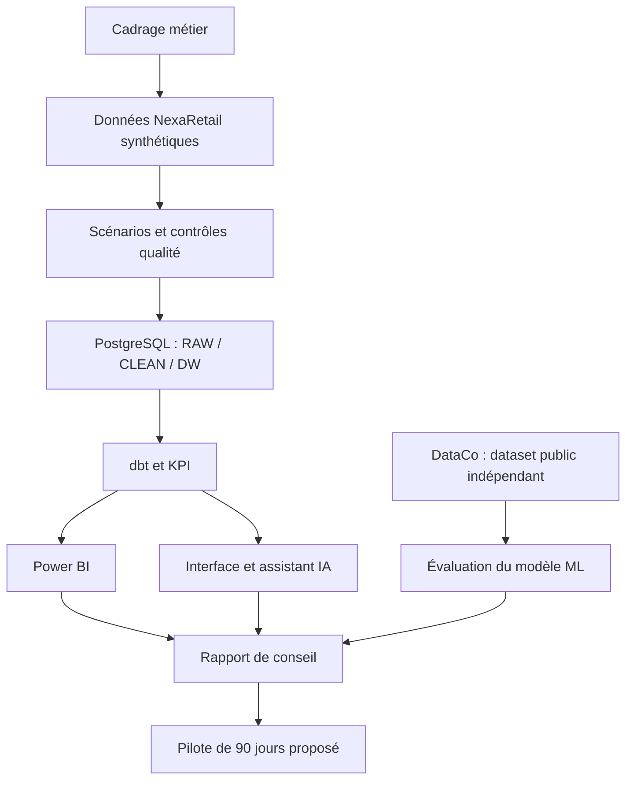

# ConsultAI 360 : centre de documentation

**NEXARETAIL | DATA QUALITY | BUSINESS INTELLIGENCE | MACHINE LEARNING | CONSEIL**

Une mission complète de transformation Data et IA, de la fiabilité des données à la recommandation stratégique.

[**Découvrir le projet**](../README.md) | [**Ouvrir l'application Streamlit**](https://consultai-360.streamlit.app/) | [**Lire le rapport final**](12_rapport_final_conseil.md)

---

## Commencer ici

ConsultAI 360 est un **cas d'étude de conseil** réalisé sur une entreprise fictive, NexaRetail. Les données commerciales et les scénarios de dégradation sont synthétiques. Le modèle de prédiction est évalué séparément sur **DataCo**, un dataset public. Les scénarios de ROI sont des simulations financières, et non des gains réalisés.

| Votre objectif | Point de départ | Suite recommandée |
|---|---|---|
| **Évaluer le projet en 5 minutes** | [Rapport final de conseil](12_rapport_final_conseil.md) | [Power BI](10_rapport_power_bi.md), [validation](11_validation_reproductibilite.md) |
| **Comprendre la mission métier** | [Contexte](01_contexte_metier.md) | [Diagnostic](02_diagnostic_metier.md), [KPI](04_dictionnaire_indicateurs.md) |
| **Examiner les choix Data Engineering** | [Schéma relationnel](modele_donnees/01_schema_relationnel.md) | [Organisation technique](guides/organisation_technique.md), [dbt](../dbt_nexaretail/README.md) |
| **Évaluer le Machine Learning** | [Problématique ML](07_problematique_prediction.md) | [Résultats et limites](08_rapport_final_prediction.md) |
| **Comprendre l'interface et l'API** | [Documentation API](09_documentation_api.md) | [Guide assistant](guides/installation_assistant_ia.md) |
| **Reconstituer le parcours du projet** | [Feuille de route et bilan](feuille_de_route.md) | [Charte](06_charte_projet.md), [validation](11_validation_reproductibilite.md) |

## Le projet en une image

**Comment lire ce schéma :** il présente les domaines de travail et leur articulation métier. Il ne signifie pas que DataCo a été fusionné avec NexaRetail ou que tous les composants sont déployés ensemble.

## Les 12 chapitres de la mission

### 01 à 06 : cadrage, données et gouvernance

| Chapitre | Contenu | Question principale |
|---|---|---|
| [01. Contexte métier](01_contexte_metier.md) | NexaRetail, omnicanal, enjeux et décisions | Pourquoi lancer la mission ? |
| [02. Diagnostic métier](02_diagnostic_metier.md) | Anomalies, risques, investigation et priorisation | Qu'est-ce qui dégrade la qualité de l'information ? |
| [03. Processus métier](03_processus_metier.md) | Commandes, paiements, expéditions, réclamations | Où apparaissent les données et les ruptures ? |
| [04. Dictionnaire des KPI](04_dictionnaire_indicateurs.md) | Définitions, formules, granularités, exclusions | Comment calculer sans induire en erreur ? |
| [05. Périmètre du projet](05_perimetre_projet.md) | Livrables, limites, critères de sortie | Que couvre réellement la démonstration ? |
| [06. Charte de projet](06_charte_projet.md) | Arbitrages, responsabilités et gouvernance | Comment piloter les travaux et les décisions ? |

### 07 à 12 : analyse, interfaces, validation et conseil

| Chapitre | Contenu | Question principale |
|---|---|---|
| [07. Problématique de prédiction](07_problematique_prediction.md) | DataCo, cible, grain, fuites et protocole | Que peut-on prédire sans information future ? |
| [08. Évaluation du modèle](08_rapport_final_prediction.md) | Baseline, Random Forest, métriques, erreurs | Quel compromis offre le modèle ? |
| [09. API et Streamlit](09_documentation_api.md) | Routes, modes de données, limites de l'interface | Comment consulter les résultats ? |
| [10. Rapport Power BI](10_rapport_power_bi.md) | Sept pages, mesures, sources et navigation | Comment restituer les analyses ? |
| [11. Validation et reproductibilité](11_validation_reproductibilite.md) | Tests, preuves historiques et contrôles restants | Qu'est-ce qui est réellement vérifié ? |
| [12. Rapport final de conseil](12_rapport_final_conseil.md) | Synthèse, ROI, recommandations et pilote | Que recommander à la direction ? |

Chaque chapitre comporte une navigation vers les sections voisines et des explications visuelles adaptées à son sujet.

## Résultats clés : périmètres à ne pas mélanger

| Domaine | Résultat documenté | Lecture correcte |
|---|---|---|
| NexaRetail | Quatre scénarios : ORIGINAL, LOW, MEDIUM, CRITICAL | Simulation de dégradation de données |
| NexaRetail | 120 000 commandes dans ORIGINAL | Volume de commandes de référence |
| Data Engineering | 53 éléments réussis lors d'un `dbt build` historique | 16 modèles et 37 tests, pas 53 tests |
| Machine Learning | ROC-AUC Random Forest de 76,05 % | Résultat sur DataCo, pas sur NexaRetail |
| Reporting | Sept pages Power BI documentées | Les sources et filtres varient selon la page |
| Finance | ROI prudent 36,5 %, central 110 %, optimiste 194 % | Scénarios hypothétiques, pas gains observés |
| Stratégie | Pilote proposé de 90 jours | Aucune industrialisation immédiate revendiquée |

Pour les hypothèses, dates et restrictions, consulter [la validation](11_validation_reproductibilite.md), [le rapport ML](08_rapport_final_prediction.md) et [le rapport de conseil](12_rapport_final_conseil.md).

## Documentation technique et ressources complémentaires

### Données, architecture et transformations

| Ressource | Usage |
|---|---|
| [Schéma relationnel NexaRetail](modele_donnees/01_schema_relationnel.md) | Tables, relations, cardinalités, volumes et contrôles SQL |
| [Organisation technique du dépôt](guides/organisation_technique.md) | Dossiers, dépendances, chemins et diagnostics |
| [Guide des transformations dbt](../dbt_nexaretail/README.md) | Modèles, sources, tests et commandes de contrôle |
| [Guide de l'environnement Docker](../docker/README.md) | Services, ports, variables, volumes et incidents connus |
| [Feuille de route et bilan d'évolution](feuille_de_route.md) | Prévisions initiales, changements et résultats documentés |

### Applications et historique des décisions

| Ressource | Usage |
|---|---|
| [Installation de l'assistant IA](guides/installation_assistant_ia.md) | Procédure locale historique, PostgreSQL et Ollama |
| [Documentation de l'API actuelle](09_documentation_api.md) | Routes FastAPI, réponses et modes de données |
| [Ancienne proposition API, archive](archives/09_ancienne_proposition_api.md) | Comparaison entre une conception abandonnée et le code actuel |
| [Application Streamlit](https://consultai-360.streamlit.app/) | Adresse publique communiquée pour la démonstration |

L'archive API n'est pas un guide d'exécution. L'URL Streamlit ne garantit pas à elle seule la disponibilité de PostgreSQL, d'Ollama ou d'une API publique.

## Parcours de lecture par profil

<strong>Direction, recruteur ou jury : comprendre la valeur et les limites</strong>

1. [Contexte métier](01_contexte_metier.md) : comprendre le problème.
2. [Rapport Power BI](10_rapport_power_bi.md) : voir comment les indicateurs sont organisés.
3. [Rapport final de conseil](12_rapport_final_conseil.md) : examiner les scénarios et la recommandation.
4. [Validation](11_validation_reproductibilite.md) : vérifier le niveau de preuve.

**Question à garder en tête :** qu'est-ce qui est mesuré, simulé ou seulement proposé ?

<strong>Consultant Data ou Business Analyst : suivre le raisonnement métier</strong>

1. [Diagnostic](02_diagnostic_metier.md) et [processus](03_processus_metier.md).
2. [Dictionnaire KPI](04_dictionnaire_indicateurs.md).
3. [Périmètre](05_perimetre_projet.md) et [charte](06_charte_projet.md).
4. [Rapport de conseil](12_rapport_final_conseil.md).

**Question à garder en tête :** quelle décision est soutenue par chaque indicateur et avec quelle couverture ?

<strong>Data Engineer ou Analytics Engineer : inspecter la chaîne de données</strong>

1. [Schéma relationnel](modele_donnees/01_schema_relationnel.md).
2. [Organisation technique](guides/organisation_technique.md).
3. [Guide dbt](../dbt_nexaretail/README.md) et [guide Docker](../docker/README.md).
4. [Validation](11_validation_reproductibilite.md).

**Question à garder en tête :** quelles transformations sont reproductibles et lesquelles dépendent de données ou d'une configuration locale ?

<strong>Data Scientist ou développeur IA : examiner le protocole et les interfaces</strong>

1. [Problématique ML](07_problematique_prediction.md).
2. [Rapport d'évaluation ML](08_rapport_final_prediction.md).
3. [Documentation API](09_documentation_api.md).
4. [Installation assistant](guides/installation_assistant_ia.md).
5. [Validation](11_validation_reproductibilite.md).

**Question à garder en tête :** les variables sont-elles disponibles au moment de prédiction et les résultats sont-ils transposables ?

## Repères de lecture et conventions

- **Résultat mesuré :** valeur issue d'une exécution documentée, dans son périmètre.
- **Résultat historique :** valeur ou test conservé d'une exécution antérieure, non nécessairement relancé aujourd'hui.
- **Simulation :** valeur produite à partir de données fictives ou d'hypothèses financières.
- **Recommandation :** action proposée, qui ne constitue pas une preuve d'effet réel.
- **Archive :** décision ou version ancienne conservée pour traçabilité, sans statut de référence active.

Les chapitres métier et les synthèses sont dans `docs/`. Les guides sont dans `docs/guides/`, les schémas dans `docs/modele_donnees/` et les versions historiques dans `docs/archives/`. Les fichiers techniques `README.md` restent à l'intérieur de leurs sous-projets pour être affichés automatiquement par GitHub.

---

**ConsultAI 360 | Documentation de la mission NexaRetail**

[Accueil du dépôt](../README.md) | [Feuille de route](feuille_de_route.md) | [Rapport final](12_rapport_final_conseil.md) | [Démonstration Streamlit](https://consultai-360.streamlit.app/)

