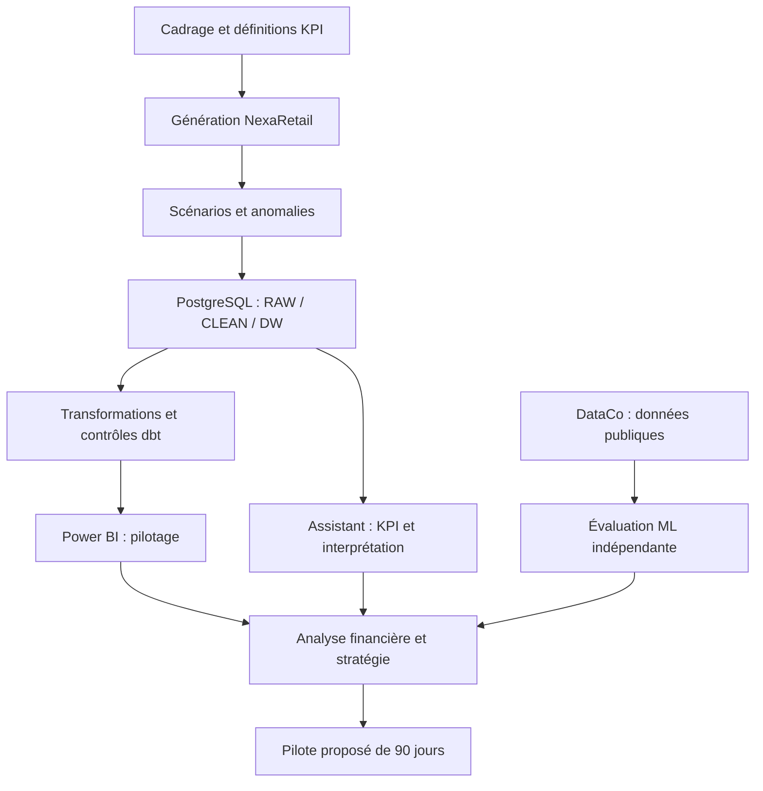

# ConsultAI 360 : feuille de route et bilan d'évolution

**Entreprise :** NexaRetail (fictive)

**Mission :** Transformation Data & Intelligence Artificielle

**Durée prévisionnelle initiale :** 180 heures (estimation, pas temps effectivement chronométré)

**Nature du document :** Plan initial conservé et bilan rétrospectif documenté

**Lecture :** les sections 1 à 16 décrivent le cadrage prévisionnel, et non un journal d'exécution. Les sections 17 à 24 confrontent ce cadrage aux livrables et aux preuves disponibles.

[Sommaire documentaire](INDEX.md) | [Rapport de conseil](12_rapport_final_conseil.md) | [Application Streamlit](https://consultai-360.streamlit.app/)

## 1. Présentation du projet

ConsultAI 360 simule une mission complète de conseil en transformation Data & IA pour NexaRetail, une entreprise fictive française spécialisée dans le commerce omnicanal.

Le projet couvre l'ensemble du cycle de valorisation des données : génération, contrôle qualité, stockage, transformation, analyse, prédiction et exploitation par l'intelligence artificielle.

Il comprend également une évaluation financière et des recommandations stratégiques.

## 2. Organisation générale

| Phase | Activité | Durée estimée |
|---|---|---:|
| 1 | Cadrage métier | 6 h |
| 2 | Génération des données synthétiques | 10 h |
| 3 | Injection d'anomalies et Excel | 10 h |
| 4 | PostgreSQL et qualité des données | 15 h |
| 5 | Data Warehouse et dbt | 15 h |
| 6 | Power BI | 18 h |
| 7 | Machine Learning | 17 h |
| 8 | Assistant IA et Streamlit | 24 h |
| 9 | Analyse financière et ROI | 14 h |
| 10 | Stratégie de transformation | 8 h |
| 11 | Tests et documentation | 21 h |
| 12 | Rapport, présentation et GitHub | 22 h |
| **Total** | | **180 h** |

## 3. Phase 1 : Cadrage métier

**Objectif :** définir les besoins de NexaRetail et les limites de la mission.

**Travaux prévus :**
1. Présentation de NexaRetail.
2. Diagnostic des problématiques métier.
3. Cartographie des processus.
4. Définition des KPI.
5. Définition du périmètre.
6. Validation du cadrage.

**Livrables :** documents de cadrage, diagnostic métier, dictionnaire des KPI et charte de projet.

## 4. Phase 2 : Génération des données synthétiques

**Objectif :** construire un environnement de données réaliste et reproductible.

**Travaux prévus :**
1. Définition du schéma relationnel.
2. Développement des scripts Python.
3. Génération des clients, magasins, produits et employés.
4. Génération des commandes et paiements.
5. Génération des livraisons et réclamations.
6. Vérification des relations entre les tables.
7. Contrôle de la cohérence initiale.
8. Documentation des règles de génération.

**Livrables :** jeux de données synthétiques, scripts Python et documentation technique.

## 5. Phase 3 : Injection d'anomalies et Excel

**Objectif :** simuler des problèmes de qualité des données et établir un diagnostic initial.

**Travaux prévus :**
1. Définition des catégories d'anomalies.
2. Injection contrôlée d'erreurs.
3. Conservation d'une référence des anomalies injectées.
4. Exploration et contrôles dans Excel.
5. Mesure de la qualité initiale.
6. Documentation des anomalies.

**Livrables :** données corrompues, registre des anomalies et rapport de diagnostic.

## 6. Phase 4 : PostgreSQL et qualité des données

**Objectif :** centraliser, contrôler et fiabiliser les données.

**Travaux prévus :**
1. Création de la base PostgreSQL.
2. Importation des données.
3. Développement des contrôles SQL.
4. Détection des anomalies.
5. Application des règles de nettoyage.
6. Évaluation de la précision et du rappel.
7. Vérification des résultats.

**Livrables :** base PostgreSQL, scripts SQL et rapport de qualité.

## 7. Phase 5 : Data Warehouse et dbt

**Objectif :** structurer les données pour les analyses décisionnelles.

**Travaux prévus :**
1. Définition du modèle dimensionnel.
2. Création des tables de faits et dimensions.
3. Développement des transformations dbt.
4. Implémentation des tests.
5. Documentation des modèles.
6. Validation des indicateurs.

**Livrables :** Data Warehouse, projet dbt et documentation du modèle.

## 8. Phase 6 : Power BI

**Objectif :** développer un environnement de pilotage interactif.

**Travaux prévus :**
1. Connexion aux données.
2. Construction du modèle Power BI.
3. Création des mesures DAX.
4. Développement de quatre pages :
   - Vue générale.
   - Performances commerciales.
   - Performance logistique.
   - Qualité des données.
5. Intégration des filtres et interactions.
6. Vérification des KPI.

**Livrables :** rapport Power BI interactif et dictionnaire des mesures.

## 9. Phase 7 : Machine Learning

**Objectif :** expérimenter une approche prédictive sur des données publiques adaptées.

**Travaux prévus :**
1. Sélection du dataset.
2. Analyse exploratoire.
3. Préparation des variables.
4. Définition d'un modèle de référence.
5. Entraînement de modèles prédictifs.
6. Comparaison des performances.
7. Interprétation des résultats.
8. Analyse des limites.

**Livrables :** notebooks, modèles évalués et rapport Machine Learning.

## 10. Phase 8 : Assistant IA et Streamlit

**Objectif :** développer une interface d'analyse assistée par IA.

**Travaux prévus :**
1. Conception de l'interface Streamlit.
2. Connexion aux résultats analytiques.
3. Intégration des KPI.
4. Développement de l'assistant IA.
5. Génération de diagnostics.
6. Formulation de recommandations.
7. Contrôle des réponses.
8. Évaluation sur un ensemble de questions de test.

**Livrables :** application Streamlit, assistant IA et rapport d'évaluation.

## 11. Phase 9 : Analyse financière et ROI

**Objectif :** estimer la valeur économique de la transformation.

**Travaux prévus :**
1. Identification des coûts.
2. Estimation des gains potentiels.
3. Construction de trois scénarios financiers.
4. Calcul du ROI.
5. Analyse de sensibilité.
6. Interprétation des résultats.

**Livrables :** modèle financier et rapport d'analyse du ROI.

## 12. Phase 10 : Stratégie de transformation

**Objectif :** formuler une stratégie Data & IA adaptée aux besoins de NexaRetail.

**Travaux prévus :**
1. Identification des initiatives prioritaires.
2. Évaluation de leur impact et de leur faisabilité.
3. Construction d'une matrice de priorisation.
4. Définition d'une feuille de route à 3, 6 et 12 mois.
5. Formulation des recommandations stratégiques.

**Livrables :** stratégie de transformation et plan d'action.

## 13. Phase 11 : Tests et documentation

**Objectif :** garantir la cohérence et la reproductibilité des résultats.

**Travaux prévus :**
1. Tests des scripts Python.
2. Vérification des transformations SQL.
3. Validation des modèles dbt.
4. Contrôle des KPI Power BI.
5. Évaluation des modèles prédictifs.
6. Tests de l'assistant IA.
7. Documentation technique.
8. Vérification de la reproductibilité.

**Livrables :** rapports de tests et documentation consolidée.

## 14. Phase 12 : Rapport et finalisation

**Objectif :** présenter les résultats sous une forme professionnelle.

**Travaux prévus :**
1. Rédaction du rapport final.
2. Présentation de la méthodologie.
3. Synthèse des résultats techniques.
4. Présentation de l'analyse financière.
5. Formulation des recommandations.
6. Préparation de la présentation.
7. Organisation du dépôt GitHub.
8. Vérification finale des livrables.

**Livrables :** rapport professionnel, présentation et dépôt GitHub documenté.

## 15. Principes méthodologiques

Le développement de ConsultAI 360 repose sur les principes suivants :

- Privilégier la qualité des résultats à la multiplication des fonctionnalités.
- Documenter les hypothèses et les décisions techniques.
- Séparer clairement les données synthétiques des données publiques.
- Vérifier les calculs avant leur interprétation par l'IA.
- Garantir la reproductibilité des analyses.
- Conserver un historique Git des développements.
- Relier les résultats techniques aux besoins métier.
- Distinguer les gains financiers simulés des résultats réellement observés.

## 16. Conclusion

Cette feuille de route constitue le cadre méthodologique de ConsultAI 360.

Elle définit les activités, les objectifs et les livrables des douze phases du projet.

Elle est destinée à rester un document de référence stable, indépendamment de l'avancement des travaux.

---

## 17. Du plan initial au périmètre effectivement documenté

Le tableau des 180 heures ci-dessus est un **budget de temps initial**. Il ne permet pas de calculer le temps réel passé sur le projet. Plusieurs travaux ont évolué pendant la réalisation : le dashboard s'est étendu, le volet API a été formalisé, et les preuves de reproductibilité ont été distinguées des résultats historiques.

| Axe | Intention initiale | Évolution documentée | Limite à garder visible |
|---|---|---|---|
| Données | Générer et dégrader des données fictives | Quatre scénarios NexaRetail : ORIGINAL, LOW, MEDIUM, CRITICAL | Simulation, pas observation client |
| Stockage et qualité | PostgreSQL et contrôles SQL | Structuration RAW, CLEAN et DW, rapprochements et règles de qualité | La couverture d'un KPI peut varier selon le scénario |
| Transformations | Construire un projet dbt | Bilan historique de 16 modèles et 37 tests réussis | Reconstruction sur machine vierge non démontrée |
| BI | Quatre pages | Rapport décrit sur **sept pages** | Contrôler le fichier Power BI avant de certifier son état actuel |
| ML | Expérience prédictive sur données publiques | DataCo, risque de retard, baseline et Random Forest | Modèle non validé sur NexaRetail |
| Assistant | Streamlit et commentaires IA | Fonctions KPI autorisées, contrôles de commentaire, interface de démonstration | Disponibilité cloud et connexion aux sources à vérifier séparément |
| API | Non isolée dans les douze phases | Documentation de routes FastAPI locales | API publique non démontrée |
| Finance | Trois scénarios ROI | Scénarios prudent, central et optimiste | Hypothèses de simulation, pas gains réalisés |
| Stratégie | Plan de transformation | Recommandation de pilote limité de 90 jours | Production immédiate non recommandée |

## 18. Carte de la chaîne de valeur

La branche DataCo reste **distincte** de la chaîne transactionnelle NexaRetail. Le diagramme représente la logique de restitution du projet, sans affirmer une connexion technique directe entre toutes les briques.

## 19. Les quatre scénarios NexaRetail

| Scénario | Volume RAW documenté, toutes tables confondues | Usage analytique |
|---|---:|---|
| ORIGINAL | 1 006 394 lignes | Référence synthétique initiale |
| LOW | 1 011 524 lignes | Perturbations limitées |
| MEDIUM | 1 032 042 lignes | Perturbations intermédiaires |
| CRITICAL | 1 057 689 lignes | Perturbations plus importantes |

Ces volumes agrègent les lignes de dix tables et ne sont donc **pas des nombres de commandes**. Les scénarios servent à tester la résistance des traitements et des KPI à la dégradation des données.

### Exemple de lecture : scénario MEDIUM

Dans le bilan PostgreSQL documenté, **120 000 commandes** sont recensées, dont **114 000** avec montant renseigné. La complétude des montants est donc **95 %**. Le CA connu atteint **68 448 127,94 €** et le panier moyen sur les seules commandes à montant renseigné est d'environ **600,42 €**.

Ce CA connu ne doit pas être interprété comme un chiffre d'affaires définitivement perdu par rapport au scénario ORIGINAL. Il peut refléter une dégradation de la mesure liée aux données manquantes.

## 20. Les sept pages du rapport Power BI

| Page | Question principale | Source ou précaution |
|---|---|---|
| 01. Vue générale | Quels sont les KPI de pilotage ? | NexaRetail et scénario sélectionné |
| 02. Performance commerciale | Où se concentre l'activité ? | Ventes, canaux et magasins |
| 03. Performance logistique | Quels retards sont mesurables ? | Expéditions évaluables |
| 04. Qualité des données | Quels défauts dégradent les analyses ? | Complétude et intégrité |
| 05. Analyse IA et prédictions | Que révèle l'expérience prédictive ? | **DataCo**, non NexaRetail |
| 06. Impact financier et ROI | Quels bénéfices sont envisageables ? | Hypothèses financières |
| 07. Recommandations stratégiques | Quelles actions prioriser ? | Décision et conditions de pilote |

Le passage de quatre à sept pages est une évolution de périmètre, pas une erreur à effacer du planning initial. Les détails de conception sont consignés dans [le rapport Power BI](10_rapport_power_bi.md).

## 21. Protocole ML et résultats à interpréter

L'expérience DataCo repose sur une cible binaire de risque de retard. Le dataset source comporte **180 519 lignes d'articles** pour **65 752 commandes distinctes**. L'évaluation doit préserver la séparation des commandes entre les partitions et exclure les variables révélant l'issue après le moment de prédiction.

| Mesure rapportée pour le Random Forest | Valeur arrondie |
|---|---:|
| ROC-AUC | 76,05 % |
| Précision | 65,88 % |
| Rappel | 77,66 % |
| F1 | 71,29 % |
| Seuil de décision | 0,40 |

Un meilleur rappel peut se payer par davantage de fausses alertes. Aucun résultat sur DataCo ne constitue une validation de performance sur les commandes NexaRetail. Consulter [la problématique](07_problematique_prediction.md) et [le rapport ML](08_rapport_final_prediction.md).

## 22. Hypothèses financières et décision

| Scénario simulé | ROI présenté |
|---|---:|
| Prudent | 36,5 % |
| Central | 110 % |
| Optimiste | 194 % |

Ces pourcentages sont des **estimations conditionnelles** : ils dépendent des hypothèses de gains et de coûts retenues. Ils ne sont ni des rendements observés ni des promesses de rentabilité. Certains coûts récurrents et éléments fiscaux ne sont pas nécessairement intégrés au périmètre de calcul.

La recommandation du dossier est **GO pour un pilote instrumenté**, mais **NO-GO pour une mise en production immédiate**. Le [rapport final de conseil](12_rapport_final_conseil.md) développe les critères de décision.

## 23. Journal des arbitrages et difficultés

| Situation | Risque | Réponse méthodologique |
|---|---|---|
| Les mesures commerciales varient selon les scénarios | Confondre absence de mesure et perte de ventes | Publier complétude, dénominateur et périmètre |
| Les commandes et les expéditions ont des grains différents | Doubler des montants lors des jointures | Séparer les faits et contrôler les cardinalités |
| La première version BI ne couvrait pas toutes les analyses | Réduire le pilotage à des cartes générales | Étendre le rapport et distinguer ses sources |
| Le modèle ML utilise un dataset public distinct | Suggérer une performance sur l'entreprise fictive | Étiqueter DataCo et interdire l'extrapolation |
| Le modèle génératif peut produire des formulations non vérifiées | Mélanger chiffres calculés et texte généré | Garder les calculs déterministes et contrôler le commentaire |
| Les contrôles ont été exécutés à des moments différents | Présenter un bilan historique comme un test actuel | Dater les preuves et décrire leurs limites |
| L'environnement Docker n'a pas été intégralement revalidé | Surpromettre la reproductibilité | Documenter prérequis et incidents, sans inventer de succès |

### Une règle de restitution

Pour chaque décision technique, conserver : **la question initiale, les options considérées, le choix effectué, le contrôle appliqué et ce qui reste non démontré**. Cette structure permet de défendre le projet en entretien sans transformer une simulation en cas client réel.

## 24. Parcours de lecture et vérifications restantes

| Pour comprendre... | Document à consulter |
|---|---|
| Le problème métier | [01. Contexte](01_contexte_metier.md) et [02. Diagnostic](02_diagnostic_metier.md) |
| Le parcours des données | [03. Processus](03_processus_metier.md) et [Schéma relationnel](modele_donnees/01_schema_relationnel.md) |
| Les définitions de KPI | [04. Dictionnaire](04_dictionnaire_indicateurs.md) |
| Le périmètre et la gouvernance | [05. Périmètre](05_perimetre_projet.md) et [06. Charte](06_charte_projet.md) |
| La prédiction | [07. Problématique](07_problematique_prediction.md) et [08. Résultats](08_rapport_final_prediction.md) |
| L'interface et l'API | [09. Documentation API](09_documentation_api.md) et [Guide assistant](guides/installation_assistant_ia.md) |
| Le reporting | [10. Power BI](10_rapport_power_bi.md) |
| La qualité des preuves | [11. Validation](11_validation_reproductibilite.md) |
| La décision de conseil | [12. Rapport final](12_rapport_final_conseil.md) |

Les derniers travaux de publication concernent la reconstruction de [l'index documentaire](INDEX.md) et du README principal. Une vérification technique de bout en bout sur un environnement neuf reste une démarche distincte de cette révision documentaire.
