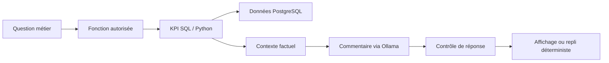

# Installation de l'assistant IA : guide historique (étape 8.3)

Ce document conserve la procédure d'installation suivie pendant l'étape 8.3. **Ne pas recopier les fichiers déjà présents dans le dépôt.** Vérifier l'environnement actuel avant toute modification.

1. Vérifier que `.env` et `.env.*` sont exclus par `.gitignore` et que les éventuels fichiers d'exemple ne contiennent aucun secret.
2. Configurer localement les variables d'environnement requises par l'assistant. Ne jamais publier `.env`. Ne pas présumer que le fichier `.env.assistant.example` existe dans la version courante.
3. Si le rôle PostgreSQL lecture seule n'existe pas encore, utiliser les instructions suivantes avec un administrateur. **Ne pas recréer un rôle déjà existant** :

```sql
CREATE ROLE assistant_ro LOGIN PASSWORD 'REMPLACER_PAR_MOT_DE_PASSE_FORT';
GRANT CONNECT ON DATABASE nexaretail_db TO assistant_ro;
GRANT USAGE ON SCHEMA dw TO assistant_ro;
GRANT SELECT ON dw.fact_orders, dw.fact_shipments TO assistant_ro;
```

Si le rôle existe déjà, ne pas réexécuter CREATE ROLE. Vérifier les permissions avec un administrateur.

4. Dans VS Code, terminal PowerShell à la racine :

```powershell
.\.venv\Scripts\python.exe -m pip install -r requirements-assistant.txt
.\.venv\Scripts\python.exe -m pytest tests/test_assistant_kpi.py -q
.\.venv\Scripts\python.exe -m src.assistant.check_connection
```

Les tests unitaires doivent réussir sans connexion DB. Le contrôle de connexion affiche deux dictionnaires calculés sur la base locale; les chiffres ne sont pas connus à l'avance.

Note : `fact_shipments` doit exister et être chargé. La requête logistique calcule le retard à partir des dates, sans supposer que `is_late` est à jour.

Ne pas commiter de secrets. Vérifier `git status` dans VS Code avant commit.

---

## Architecture et limites



L'assistant n'est pas autorisé à générer puis exécuter des requêtes SQL arbitraires. Les valeurs numériques doivent provenir des fonctions métier, pas du modèle génératif. La procédure de cette page est **historique** et doit être adaptée à l'environnement effectivement installé.

## Préparation de l'environnement

| Élément | Pourquoi | Vérification |
|---|---|---|
| Environnement virtuel Python | Isoler les dépendances | Interpréteur `.venv` accessible |
| `requirements-assistant.txt` | Installer les bibliothèques prévues | Installation sans erreur |
| PostgreSQL | Alimenter les KPI | Connexion au schéma `dw` |
| Rôle `assistant_ro` | Limiter les privilèges | `SELECT` sur les tables nécessaires |
| Ollama local | Produire les commentaires | Service accessible sur le poste |
| `.env` local | Configurer sans publier de secret | Exclusion Git confirmée |

### Ordre de diagnostic

1. Vérifier l'environnement Python et les dépendances.
2. Contrôler la connexion PostgreSQL avec `check_connection`.
3. Tester la disponibilité d'Ollama séparément.
4. Exécuter les tests de fonctions KPI.
5. Démarrer l'interface et vérifier une réponse sur un scénario connu.
6. Comparer les nombres à une requête SQL de référence.

### Problèmes fréquents

| Problème | Cause possible | Action |
|---|---|---|
| Authentification refusée | Mot de passe ou rôle incorrect | Vérifier localement la configuration, sans publier le secret |
| Table absente | DW non construit | Vérifier les tables attendues |
| Ollama inaccessible | Service local arrêté | Vérifier le service et le modèle disponible |
| Commentaire rejeté | Format ou règle métier non respectée | Examiner le repli et les garde-fous |
| Résultat inattendu | Mauvais scénario ou filtre | Rapprocher les KPI de la source |

## Sécurité et publication

L'interface de démonstration est accessible à l'adresse [ConsultAI 360 sur Streamlit](https://consultai-360.streamlit.app/). Cette URL ne démontre pas que l'environnement local PostgreSQL ou Ollama est disponible depuis le cloud. Ne jamais copier les identifiants locaux dans un dépôt ou une configuration publique.

## Documentation associée

[API actuelle](../09_documentation_api.md) | [Validation](../11_validation_reproductibilite.md) | [Guide d'organisation](organisation_technique.md) | [Sommaire](../INDEX.md)
