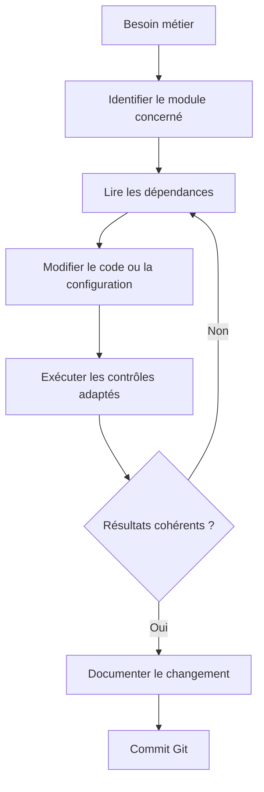

# Organisation technique : audit ciblé du dépôt

> Audit de structure et de chemins effectué à partir des fichiers GitHub. Ce document ne prétend pas constituer un inventaire exhaustif de tous les fichiers du dépôt ni une exécution de tests.

## Règles de classement

- `src/` : code Python métier, préparation et évaluation des données.
- `sql/` : requêtes et scripts PostgreSQL, conservés avec leur numérotation actuelle.
- `dbt_nexaretail/` : projet dbt et configuration des modèles.
- `tests/` : tests Python, y compris `test_project_knowledge.py` déplacé depuis `docs/`.
- `docs/` : documents métier, rapports narratifs, guides et archives.
- `reports/` : sorties techniques et artefacts d'analyse ; ne pas déplacer sans modifier les chemins dans les scripts.
- `rapports/` : rapport PDF historique, conservé en l'état car il est référencé depuis `README.md` et le rapport final.
- `data/` : données d'entrée, généralement locales et exclues de Git.
- `models/`, `mlruns/`, `mlartifacts/` : artefacts ML locaux ou générés ; ne pas publier automatiquement les fichiers volumineux.
- `ConsultIA_PowerBI.Report/` et `ConsultIA_PowerBI.SemanticModel/` : structure technique Power BI, à conserver avec le fichier `.pbip`.

## Dépendances de chemins vérifiées

| Script | Chemin utilisé | Décision |
|---|---|---|
| `src/ml/eda_dataco.py` | `data/external/dataco/DataCoSupplyChainDataset.csv` | Conserver |
| `src/ml/eda_dataco_visuals.py` | `reports/ml/dataco_orders_audit.csv` et `reports/ml/figures/` | Conserver |
| `src/ml/prepare_dataco.py` | `reports/ml/dataco_orders_audit.csv` et `reports/ml/processed/` | Conserver |
| `src/ml/compare_shipping_baseline.py` | `reports/ml/processed/` et `reports/ml/model_comparison/` | Conserver |
| `src/ml/evaluate_dataco_thresholds.py` | `reports/ml/processed/` et `reports/ml/threshold_analysis/` | Conserver |
| `src/ml/explain_dataco.py` | `reports/ml/processed/` et `reports/ml/explainability/` | Conserver |
| `src/ml/mlflow_dataco.py` | `reports/ml/processed/` et `reports/ml/mlruns/` | Conserver |
| `src/ml/final_evaluation_dataco.py` | `reports/ml/final_evaluation/` et `docs/08_rapport_final_prediction.md` | Chemin documentaire corrigé |

Le rapport final ML est généré par un script. **Une nouvelle exécution peut remplacer le document existant.** Examiner le diff avant tout commit.

## Contrôles après synchronisation

Depuis la racine du projet, dans l'environnement Python approprié :

```powershell
git status -sb
python -m pytest tests/test_project_knowledge.py tests/test_api_step9.py tests/test_api_postgres_step9.py -q
git diff --check
```

Si le test de connaissances échoue après déplacement, vérifier le chemin d'import de `project_knowledge.py` et la configuration de collecte pytest.

## Décisions différées

1. Ne pas fusionner `reports/` et `rapports/` avant de réécrire toutes les références, y compris les liens PDF.
2. Ne pas renommer les dossiers de sorties ML : leurs chemins sont codés en dur dans plusieurs scripts.
3. Ne pas renommer les éléments techniques Power BI ou dbt sans test de reconstruction.
4. Examiner séparément les anciens fichiers générés et les gros fichiers avant toute suppression.
5. Faire une recherche complète des références locales avant les prochains déplacements.

---

## Parcours d'une modification technique



## Matrice des responsabilités des dossiers

| Dossier | Question à laquelle il répond | À ne pas confondre avec |
|---|---|---|
| `src/ml/` | Comment le modèle DataCo est-il préparé et évalué ? | Un modèle déployé sur NexaRetail |
| `src/assistant/` | Comment les KPI sont-ils calculés et commentés ? | Une IA qui produit librement du SQL |
| `api/` | Quelles routes HTTP locales sont exposées ? | L'interface Streamlit publique |
| `dbt_nexaretail/` | Comment les modèles analytiques sont-ils transformés ? | Les scripts d'import des sources |
| `docker/` | Comment dbt se connecte-t-il au service PostgreSQL Docker ? | L'ensemble du projet Compose, situé à la racine |
| `reports/` | Où sont conservées des sorties et artefacts ? | `rapports/`, qui contient un PDF historique |

## Avant de déplacer un fichier

1. Rechercher les références du chemin dans les scripts, tests, guides et fichiers de configuration.
2. Vérifier les chemins relatifs depuis la racine du dépôt.
3. Préserver les sorties ML générées et les références Power BI.
4. Tester le composant concerné dans l'environnement approprié.
5. Inspecter `git diff --check` et `git status -sb` avant commit.

### Exemples de commandes de lecture

```powershell
git status -sb
git diff --stat
git diff --check
```

Ces commandes **n'exécutent pas** le pipeline de données. Elles contrôlent uniquement l'état des modifications Git.

## Attention aux fichiers générés

Le script `src/ml/final_evaluation_dataco.py` peut réécrire `docs/08_rapport_final_prediction.md`. Toute réexécution doit être suivie d'une inspection du diff pour éviter d'écraser les enrichissements rédactionnels.

Les données locales, les artefacts de modèles et les secrets ne doivent pas être ajoutés automatiquement au dépôt. Une absence de fichier volumineux dans Git ne prouve pas qu'il manque à l'environnement de travail original.

## Diagnostic rapide selon le symptôme

| Symptôme | Première vérification |
|---|---|
| `ModuleNotFoundError` | Environnement Python et racine d'exécution |
| Fichier DataCo introuvable | Chemin `data/external/dataco/` et disponibilité locale |
| Échec de connexion PostgreSQL | Hôte, port, base et droits |
| `dbt debug` échoue | Profil, mot de passe et réseau Docker |
| Power BI ne retrouve pas son modèle | Présence des dossiers `.Report` et `.SemanticModel` |
| Chiffres différents entre SQL et BI | Grain, scénario, filtres et données manquantes |

## Références

[Schéma relationnel](../modele_donnees/01_schema_relationnel.md) | [Installation assistant](installation_assistant_ia.md) | [Guide dbt](../../dbt_nexaretail/README.md) | [Guide Docker](../../docker/README.md) | [Validation](../11_validation_reproductibilite.md)
